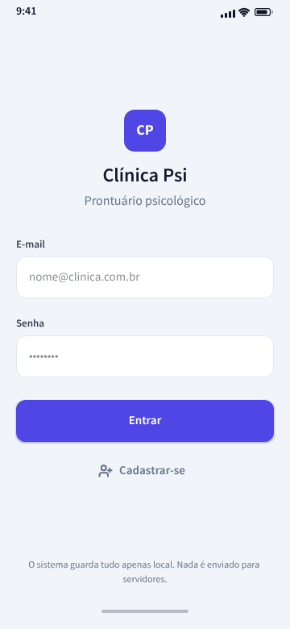

# Guia 01 — Tela de Login (Expo Go + Snack)

**Projeto:** Clínica Psi — Prontuário para Psicólogos  
**Arquivo de referência visual:** `login-s21fe.png` (nesta mesma pasta)  
**Objetivo:** implementar a primeira tela do app mobile exatamente como o mock do Penpot, sem conectores, sem backend, sem navegação — só a tela, com a UX e a estrutura corretas desde o início.

\


---

## 0. Antes de tudo — o que você vai ver neste guia

Este guia cobre, do zero:

1. o caminho mais curto: **Snack** (snack.expo.dev) + **Expo Go** no seu celular;
2. o código completo e comentado da tela (3 arquivos);
3. a lógica React por trás de cada escolha (estado, hooks, eventos, teclado);
4. erros mais comuns e o que fazer em cada caso;
5. o checklist de conferência para garantir que a tela ficou igual ao mock;
6. os limites — o que **não** entra agora (navegação, auth de verdade, cadastro).

Herança: o mock veio do Penpot e espelha a tela de Login do app web (`psipront.vercel.app`). O setup é o mesmo — a diferença é que aqui usamos React Native.

---

## 1. O que a tela tem que ter (referência do mock)

| Elemento | Detalhe visual (do `login-s21fe.png`) |
|---|---|
| Barra de status | `9:41` à esquerda, sinal/wifi/bateria à direita |
| Marca | Quadrado indigo `#4F46E5`, ~64px, borda arredondada ~14px, "CP" branco |
| Título | `Clínica Psi` — negrito, escuro (`#0F172A`), ~22px |
| Subtítulo | `Prontuário psicológico` — cinza (`#64748B`), ~13px |
| Campo 1 | Rótulo `E-mail` (pequeno, semi-negrito) + input branco com placeholder `nome@clinica.com.br`, borda sutil, raio 8px, altura ~48px |
| Campo 2 | Rótulo `Senha` + password com pontinhos. No app real a senha **nunca** aparece na tela |
| Botão | `Entrar` — indigo `#4F46E5` cheio, texto branco, raio 8px, largura toda, altura ~52px |
| Link | `Cadastrar-se` — texto indigo `#4F46E5`, com ícone de pessoa-mais |
| Rodapé | `O sistema guarda tudo apenas local. Nada é enviado para servidores.` — cinza, centralizado, ~11px |
| Fundo | `#F1F3F8` (cinza-azulado bem claro) |
| Indicador home | Barrazinha cinza centralizada embaixo |

**Regra de ouro:** cores, pesos e espaçamentos não são invenção — vêm do Penpot. Não "melhorar" o mock.

---

## 2. O que é o Expo Go e por que começar por ele

**Expo Go** é um app gratuito (Play Store / App Store) que executa o seu projeto Expo no celular físico, sem compilar nada. Ele traz:

- **Sandbox isolado**: roda o bundle JavaScript do seu app e o motor de navegação — sem instalar Android Studio nem Xcode;
- **Fast Refresh**: salvou o arquivo, a tela atualiza em ~1s;
- Limitação honesta: não tem módulos nativos customizados (nada de Bluetoot ou biometric SDK novo), nem “ifranjamento” de telas. **Para a Fase 1 do app, isso não é obstáculo.**

**Snack** (snack.expo.dev) é o editor Expo na nuvem: você escreve o código no navegador e ele roda ao vivo no celular. É o caminho mais rápido para validar a tela. Depois de provada no Snack, o projeto sai de lá convertido para um projeto local (`npx create-expo-app`) — a Fase 1 não exige isso, mas o mesmo código serve.

---

## 3. Pré-requisitos (10 minutos)

1. **Node.js LTS** (18+ or 20+) instalado — só para o caminho local depois; no Snack, nada precisa ser instalado;
2. **Expo Go** instalado no celular (Play Store / App Store), aberto, com a tela inicial visível;
3. Celular e computador/no-navegador no mesmo Wi-Fi (para o caminho local). No Snack, o celular apenas acessa a internet;
4. Navegador aberto em **https://snack.expo.dev** (conta Expo gratuita ajuda a salvar o projeto).

**Confirme antes de escrever código:** abra o Expo Go → ele deve esperar QR/código (`.expo`). Enquanto isso, não se preocupe — é aqui que vamos parar o teclado depois; primeiro a tela.

---

## 4. Criar o projeto no Snack (do zero)

### Passo 1 — Resetar o sandbox
Entre em snack.expo.dev → clique **“Nueva página” / “New project”** (ou **“Reset demo content”** se houver conteúdo demo). O Snack já vem com:

- `App.js` na raiz;
- `package.json` com o SDK Expo mais recente;
- `node_modules` gerenciado para você — **nunca edite `package.json` manualmente sem motivo**.

### Passo 2 — Trocar o conteúdo default
Selecione todo o código demo em `App.js` e substitua pelo conteúdo deste guia (seções 5–6). Um por vez, salvando sempre.

### Passo 3 — Criar as pastas/arquivos
No painel esquerdo do Snack, clique em **“+”** e crie:

```
src/theme.js          → cores e tokens de design
src/screens/LoginScreen.tsx → a tela
```

Snack não deixa criar pasta diretamente — o caminho com `/` no nome cria as pastas sozinho.

### Passo 4 — Ver o resultado
Clique **“Run”** (canto superior direito) → escaneie o QR com o Expo Go. A tela deve aparecer. Se algo quebrar, vá para a **Parte 6 — Troubleshooting** (o Snack mostra erro na aba **“Console”**).

---

## 5. O código completo (Fase 1 — sem backend)

Três arquivos. Copie na ordem: `src/theme.js` → `src/screens/LoginScreen.tsx` → `App.js`.

### 5.1 `src/theme.js` — tokens de design (fonte única de cores)

```ts
// src/theme.js
export const colors = {
  bg: '#F1F3F8',        // fundo geral (igual ao mock)
  surface: '#FFFFFF',   // cartões/inputs
  border: '#E2E8F0',    // borda de inputs e botões neutros
  primary: '#4F46E5',   // indigo do mock (botão, logo, link)
  primaryDark: '#4338CA', // hover/pressed (não precisa agora, mas fica registrado)
  text: '#0F172A',      // títulos (quase preto)
  textMuted: '#64748B', // subtítulos, rodapé
  label: '#475569',     // rótulos dos campos
  placeholder: '#94A3B8', // placeholder (no mock o input é branco com texto visível)
  error: '#DC2626',     // erros de validação
  errorBg: '#FEF2F2',   // fundo do alerta de erro
};

export const spacing = {
  xs: 4, sm: 8, md: 16, lg: 24, xl: 32,
};
```

**Por que tokens e não cores no meio do código?** Porque o mock tem `#4F46E5` como identidade. Num arquivo único, se o cliente quiser indigo mais claro amanhã, você muda **1 linha**, não 14.

### 5.2 `src/screens/LoginScreen.tsx` — a tela

```tsx
// src/screens/LoginScreen.tsx
import { useCallback, useState } from 'react';
import {
  Keyboard,
  KeyboardAvoidingView,
  Platform,
  ScrollView,
  StyleSheet,
  StatusBar,
  Text,
  TextInput,
  TouchableOpacity,
  View,
  Alert,
  ActivityIndicator,
} from 'react-native';
import { Ionicons } from '@expo/vector-icons';

import { colors } from '../theme';

// Regex prática para validação de e-mail em nível de UX.
// Não tenta validar RFC completo — só o suficiente para barrar erro de digitação.
const EMAIL_REGEX = /^[^\s@]+@[^\s@]+\.[^\s@]{2,}$/;

// Props opcionais: a tela funciona sozinha (Alert de demonstração), ligada à
// navegação por props (Rota A: o pai passa onCadastrar/onEntrar) ou à navegação
// por stack nativa (Rota B: o React Navigation passa `navigation`).
type Props = {
  onCadastrar?: () => void;
  onEntrar?: () => void;
  navigation?: {
    navigate?: (name: 'Cadastro1' | 'Painel') => void;
    replace?: (name: 'Painel') => void;
  };
};

export default function LoginScreen({ onCadastrar, onEntrar, navigation }: Props = {}) {
  const [email, setEmail] = useState('');
  const [password, setPassword] = useState('');
  const [showPassword, setShowPassword] = useState(false);
  const [loading, setLoading] = useState(false);
  const [error, setError] = useState<string | null>(null);

  const handleEntrar = useCallback(() => {
    // 1) Validação de formato — antes de qualquer outra coisa
    if (!EMAIL_REGEX.test(email.trim())) {
      setError('Informe um e-mail válido.');
      return;
    }
    if (password.length < 6) {
      setError('A senha precisa de ao menos 6 caracteres.');
      return;
    }

    // 2) Feche o teclado antes de qualquer transição
    Keyboard.dismiss();
    setError(null);
    setLoading(true);

    // 3) AQUI É MOCK: não há servidor nesta fase.
    //    Simula latência e mostra o sucesso. Troque por `AuthService.login` quando houver auth real.
    setTimeout(() => {
      setLoading(false);
      if (onEntrar) return onEntrar();
      if (navigation?.replace) return navigation.replace('Painel');
      if (navigation?.navigate) return navigation.navigate('Painel');
      Alert.alert(
        'Login (demonstração)',
        'Nesta fase não há backend. Estrutura, UX e validação estão prontas.',
        [{ text: 'OK' }]
      );
    }, 900);
  }, [email, password, onEntrar, navigation]);

  const handleCadastrar = useCallback(() => {
    if (onCadastrar) return onCadastrar();
    if (navigation?.navigate) return navigation.navigate('Cadastro1');
    Alert.alert(
      'Cadastro',
      'O fluxo de cadastro em 2 passos (Seus dados → Dados da clínica) entra depois do login.',
      [{ text: 'Entendi' }]
    );
  }, [onCadastrar, navigation]);

  return (
    <KeyboardAvoidingView
      behavior={Platform.OS === 'ios' ? 'padding' : 'height'}
      style={styles.keyboardWrap}
    >
      <ScrollView
        contentContainerStyle={styles.scroll}
        keyboardShouldPersistTaps="handled"
        showsVerticalScrollIndicator={false}
      >
        <StatusBar barStyle="dark-content" />

        {/* Marca */}
        <View style={styles.logo} accessibilityLabel="Clínica Psi">
          <Text style={styles.logoText}>CP</Text>
        </View>
        <Text style={styles.title}>Clínica Psi</Text>
        <Text style={styles.subtitle}>Prontuário psicológico</Text>

        {/* Formulário */}
        <View style={styles.form}>
          <Text style={styles.label} nativeID="email-label">E-mail</Text>
          <TextInput
            accessibilityLabelledBy="email-label"
            style={styles.input}
            placeholder="nome@clinica.com.br"
            placeholderTextColor={colors.placeholder}
            value={email}
            onChangeText={(text) => {
              setEmail(text);
              if (error) setError(null);
            }}
            autoCapitalize="none"
            autoComplete="email"
            autoCorrect={false}
            keyboardType="email-address"
            textContentType="emailAddress"
            maxLength={80}
            returnKeyType="next"
            onSubmitEditing={() => {
              // avança para a senha sem fechar o teclado
              // (implementado depois com ref; nesta fase só não trava)
            }}
          />

          <Text style={[styles.label, styles.labelSpacing]} nativeID="senha-label">Senha</Text>
          <View style={styles.passwordRow}>
            <TextInput
              accessibilityLabelledBy="senha-label"
              style={[styles.input, styles.inputFlex]}
              placeholder="••••••••"
              placeholderTextColor={colors.placeholder}
              value={password}
              onChangeText={(text) => {
                setPassword(text);
                if (error) setError(null);
              }}
              secureTextEntry={!showPassword}
              autoCapitalize="none"
              autoComplete="password"
              autoCorrect={false}
              textContentType="password"
              maxLength={64}
              returnKeyType="go"
              onSubmitEditing={handleEntrar}
            />
            <TouchableOpacity
              style={styles.eyeButton}
              onPress={() => setShowPassword((v) => !v)}
              accessibilityLabel={showPassword ? 'Ocultar senha' : 'Mostrar senha'}
              accessibilityRole="button"
              hitSlop={{ top: 8, bottom: 8, left: 8, right: 8 }}
            >
              <Ionicons
                name={showPassword ? 'eye-off-outline' : 'eye-outline'}
                size={22}
                color={colors.textMuted}
              />
            </TouchableOpacity>
          </View>

          {/* Erro inline — a régua das mensagens do web app (app usa “E-mail ou senha inválidos.”) */}
          {error ? (
            <View style={styles.errorBox} accessibilityLiveRegion="polite">
              <Ionicons name="alert-circle-outline" size={16} color={colors.error} />
              <Text style={styles.errorText}>{error}</Text>
            </View>
          ) : null}

          <TouchableOpacity
            style={[styles.button, loading && styles.buttonDisabled]}
            activeOpacity={0.85}
            onPress={handleEntrar}
            disabled={loading}
            accessibilityRole="button"
            accessibilityLabel="Entrar"
          >
            {loading ? (
              <ActivityIndicator color="#FFFFFF" />
            ) : (
              <Text style={styles.buttonText}>Entrar</Text>
            )}
          </TouchableOpacity>

          <TouchableOpacity
            style={styles.link}
            onPress={handleCadastrar}
            accessibilityRole="button"
            accessibilityLabel="Cadastrar-se"
          >
            <Ionicons name="person-add-outline" size={18} color={colors.primary} />
            <Text style={styles.linkText}>Cadastrar-se</Text>
          </TouchableOpacity>
        </View>

        {/* Rodapé — mesmo texto do web app */}
        <Text style={styles.footer}>
          O sistema guarda tudo apenas local. Nada é enviado para servidores.
        </Text>
      </ScrollView>
    </KeyboardAvoidingView>
  );
}

const styles = StyleSheet.create({
  keyboardWrap: { flex: 1, backgroundColor: colors.bg },
  scroll: {
    flexGrow: 1,
    alignItems: 'center',
    justifyContent: 'center',
    paddingHorizontal: 24,
    paddingTop: 48,
    paddingBottom: 32,
  },
  logo: {
    width: 64,
    height: 64,
    borderRadius: 14,
    backgroundColor: colors.primary,
    alignItems: 'center',
    justifyContent: 'center',
    marginBottom: 16,
  },
  logoText: { color: '#FFFFFF', fontSize: 22, fontWeight: '800', letterSpacing: 0.5 },
  title: { fontSize: 22, fontWeight: '800', color: colors.text },
  subtitle: {
    fontSize: 13,
    color: colors.textMuted,
    marginTop: 4,
    marginBottom: 28,
  },
  form: { width: '100%', maxWidth: 400 },
  label: { fontSize: 13, fontWeight: '600', color: colors.label, marginBottom: 6 },
  labelSpacing: { marginTop: 14 },
  input: {
    height: 48,
    borderRadius: 8,
    borderWidth: 1,
    borderColor: colors.border,
    backgroundColor: colors.surface,
    paddingHorizontal: 14,
    fontSize: 16,
    color: colors.text,
  },
  inputFlex: { flex: 1 },
  passwordRow: { flexDirection: 'row', alignItems: 'center' },
  eyeButton: {
    position: 'absolute',
    right: 10,
    height: 48,
    justifyContent: 'center',
    paddingHorizontal: 6,
  },
  errorBox: {
    flexDirection: 'row',
    alignItems: 'center',
    gap: 6,
    marginTop: 10,
    backgroundColor: colors.errorBg,
    borderRadius: 8,
    paddingHorizontal: 10,
    paddingVertical: 8,
  },
  errorText: { color: colors.error, fontSize: 13, flexShrink: 1 },
  button: {
    height: 52,
    borderRadius: 8,
    backgroundColor: colors.primary,
    alignItems: 'center',
    justifyContent: 'center',
    marginTop: 20,
  },
  buttonDisabled: { opacity: 0.6 },
  buttonText: { color: '#FFFFFF', fontSize: 16, fontWeight: '700' },
  link: {
    flexDirection: 'row',
    alignItems: 'center',
    justifyContent: 'center',
    gap: 8,
    marginTop: 18,
    paddingVertical: 8,
  },
  linkText: { color: colors.primary, fontSize: 15, fontWeight: '600' },
  footer: {
    fontSize: 11,
    color: colors.textMuted,
    textAlign: 'center',
    marginTop: 28,
    lineHeight: 16,
  },
});
```

### 5.3 `App.js` — só o suficiente para renderizar a tela

```tsx
// App.js
import LoginScreen from './src/screens/LoginScreen';

export default function App() {
  return <LoginScreen />;
}
```

Não instale React Navigation ainda. A navegação entra na fase seguinte, com o fluxo Cadastro → Painel.

---

## 6. Lógica de programação do front — por que cada coisa é assim

### 6.1 Estado e eventos

- **`useState`** = a tela lembra o que está digitado. Cada `TextInput` controlado exige `value` + `onChangeText`. Sem `value` → input não controlado → salto e bugs de render.
- **`useCallback`** nas funções = cria a função uma vez por dependência; evita re-render desnecessário de filhos. Nesta tela pequena faz pouca diferença, mas é o hábito certo.
- **`error` como estado**: a mensagem aparece e some sozinha quando o usuário corrige. Entregamos feedback imediato — é o que o mock não mostra, mas o web app faz (`erros de validação` no login).
- **`loading`** bloqueia duplo toque no botão e dá feedback de processo (o `ActivityIndicator` entra no lugar do texto).

### 6.2 Teclado: a parte que mais quebra projetos Expo

- `KeyboardAvoidingView` garante que o botão "Entrar" não fique escondido atrás do teclado.
- `behavior="padding"` no **iOS**: o teclado empurra o layout.
- No **Android**, `behavior="height"` encolhe a altura útil da tela pelo teclado — mais confiável que `adjustResize` em todos os dispositivos. Se mesmo assim um campo baixo ficar sob o teclado, ver Guia 02 §7.11 (`useAuthScroll` + `onFocus`).
- `ScrollView` com `keyboardShouldPersistTaps="handled"` deixa tocar no botão mesmo com teclado aberto — sem isso, o primeiro toque "fecha o teclado" e o toque seguinte é que dispara o botão.
- `Keyboard.dismiss()` no submit: fecha o teclado ao enviar, como no web app.

### 6.3 TextInput — as props que importam aqui

| Prop | Para quê |
|---|---|
| `autoCapitalize="none"` | E-mail e senha nunca começam em maiúscula automática |
| `autoComplete="email" / "password"` | Autofill correto (iOS/Android mostram sugestões salvas) |
| `textContentType="emailAddress" / "password"` | Autofill iOS; integra com chaveiro |
| `keyboardType="email-address"` | Teclado com `@` no Android/iPhone |
| `secureTextEntry={!showPassword}` | Senha pontilhada |
| `autoCorrect={false}` | Nunca "corrigir" e-mail/senha |
| `returnKeyType="go"` / `"next"` | Rótulo da tecla de retorno |
| `onSubmitEditing={handleEntrar}` | Enter dispara o envio |
| `maxLength` | Evita colar textos gigantes de colar/refresh |
| `placeholderTextColor` | Cor do placeholder (sem isso Android clareia demais) |

### 6.4 Erros tratados inline

- **E-mail inválido** → `Informe um e-mail válido.` (regex de UX, não RFC).
- **Senha curta** → `A senha precisa de ao menos 6 caracteres.` — mesmo wording do sistema web.
- Mensagem some quando o usuário digita (a borda fica no lugar certo; nada de toast por cima de tudo).
- `accessibilityLiveRegion="polite"` no erro: leitores de tela anunciam a mensagem sem arrancar o foco.

### 6.5 O que é mock (e o que NÃO é gambiarra)

- `setTimeout` de 900ms **simula latência** para você testar estados de loading/erro/sucesso. Não é funcionalidade — é andaime de UX.
- O mock do sucesso usa `Alert.alert` porque não há navegação nem backend. Quando existir auth (etapa seguinte):
  - `AsyncStorage` guarda a sessão (o sistema web é local também; no mobile seguimos o mesmo invariante: tudo neste dispositivo);
  - `Alert` vira `navigation.navigate('Painel')`;
  - `setTimeout` vira `authService.login(email, password)`.
- **Nunca** use conta demo fixa no código (o app web já recebeu esse achado de auditoria: credenciais `ana@clinica.com.br` no bundle — não repita).

### 6.6 Acessibilidade e testes futuros

- `accessibilityLabel`/`accessibilityRole`/`accessibilityLabelledBy` — leitores de tela e automação (Maestro/Playwright Native) usam os mesmos seletores.
- `nativeID="email-label"` emparelhado com `accessibilityLabelledBy="email-label"` — padrão acessível WCAG para rótulo→campo.

---

## 7. Regras de código para não errar a primeira tela

1. **Toda string de UI vive dentro de `<Text>`.** Texto solto em `<View>` é erro de runtime novo e sangue extra em desenvolvimento.
2. **Um componente por tela** começa assim; só separar `<BrandHeader>` quando a segunda tela (Cadastro) pedir o mesmo cabeçalho — não antes.
3. **Espaçamento por múltiplos de 4/8** — o mock tende a usar múltiplos de 4, não invente `17px`.
4. **Nada de `any` implícito**; `useState('')` inferimos como `string`; `useState<string | null>(null)` para o erro.
5. **Um arquivo por responsabilidade**: `theme.js` (cores), `screens/LoginScreen.tsx` (tela), `App.js` (raiz). Mais camadas agora é ruído.
6. **Nomes de arquivo em PascalCase** (`LoginScreen.tsx`), pastas em minúsculas (`screens/`, `theme.js`).
7. **Teste no aparelho real a cada 30–60 segundos.** O Snack atualiza quase em tempo real; o ciclo é escrever → salvar → olhar o telefone → corrigir.
8. Estado da UI (erro, carregando, senha visível) **é código de produção**, não enfeite — o mock no Penpot sugere; o app web faz; você mantém.

---

## 8. Troubleshooting completo

### 8.1 Tela branca / nada aparece
- **Causa 1:** string solto (ex.: um `Olá` direto dentro de `<View>`).
- **Solução:** procurar `Console` no Snack — a linha do erro aparece. Colocar todo texto em `<Text>`.
- **Causa 2:** arquivo sem `default export` (`export default function LoginScreen`) ou `App.js` não aponta certo.

### 8.2 Erro vermelho — "Element type is invalid"
- Importou algo errado (`import LoginScreen from '../screens/LoginScreen'` com caminho errado, ou esqueceu `.tsx`).
- PascalCase espelhado: no Snack o case importa — `loginScreen.tsx` ≠ `LoginScreen.tsx`.

### 8.3 "Cannot find module" / "Unable to resolve module"
- Nome do arquivo ou caminho digitado com erro; o editor de console mostra o módulo não encontrado.
- Lembre: no `App.js`, o caminho é relativo à raiz (`./src/screens/LoginScreen`).

### 8.4 Teclado não aparece / não fecha
- `TextInput` com `editable={false}` por engano, ou `pointerEvents="none"` em view ancestral.
- Teclado não fecha ao tocar fora: faltou `keyboardShouldPersistTaps="handled"` no `ScrollView`.

### 8.5 O botão "Entrar" fica atrás do teclado
- Falta `KeyboardAvoidingView` envolvendo o conteúdo, ou `ScrollView` com `contentContainerStyle={{ flexGrow: 1 }}` + `justifyContent: 'center'` — com o teclado aberto o layout pode cortar a área; o `ScrollView` ajuda a rolar.

### 8.6 Senha aparece em texto claro / você ativou `showPassword` e não voltava
- `secureTextEntry={!showPassword}` — o sinal de `!` é importante. Errado: `{showPassword}` mostra sempre a senha.

### 8.7 Placeholder não aparece
- `placeholderTextColor` ausente num tema escuro (Android usa cinza-claro padrão que some sobre branco). Definimos `colors.placeholder` explicitamente.

### 8.8 Snack lento, travado ou "verify your account"
- Snack é gratuito mas compartilhado; horários de pico travam. Alternativa: **migrar para local**:
  ```
  npm create expo-app@latest clinica-psi-mobile && cd clinica-psi-mobile
  ```
  Copie `App.js`, `src/theme.js`, `src/screens/LoginScreen.tsx`, rode `npm start` e escaneie o QR com o Expo Go. O código é o mesmo.
- Atualize o app Expo Go no celular sempre — incompatibilidade de SDK entre Expo Go e Snack/projeto é a fonte nº 1 do erro "Something went wrong".

### 8.9 Android vs iPhone — onde diferem aqui
- iOS com `behavior="padding"` no `KeyboardAvoidingView`; Android com `behavior="height"`.
- `fontWeight="800"` funciona nos dois; `100`/`900` em algum chipset antigo trava com a família sem pesos extras — mantenha múltiplos de 100 entre 400 e 800.
- `letterSpacing` normal no iOS; no Android `letterSpacing` funciona mas parece ~10% maior — se notar, reduza 0.2–0.3 unidade (já aplicado aqui: `0.5`).
- `hitSlop` no botão do olho — solta o alvo de toque nos dois sistemas (48x48 mínimo, Material).

### 8.10 Texto com acentos / "E-mail" aparece como "E-mail" ok — mas vira \u00E7 etc.
- Salve tudo UTF-8 (o Snack e o VS Code usam UTF-8 por padrão). Se algum console mostrar mojibake, é problema do template colado — regrave: apague o caractere ou pastes do arquivo que acompanha este guia.

### 8.11 O Expo Go aponta erro sem dizer onde
- Método bom e barato: **comente blocos** do componente e vá descomentando de cima para baixo até o erro aparecer. 80% dos bugs nessa fase são 1 linha (chave errada, nome errado, string solto).

### 8.12 "Rendered fewer hooks than expected"
- `useState`/`useCallback` dentro de `if` ou loop ou depois de `return` condicional. Nesta tela não há `if` acima dos hooks — mantenha tudo antes de qualquer `return`.

### 8.13 Erro de rede/timeout no QA do Snack
- O Snack também pode mostrar 401 com muita cota; crie conta gratuita Expo e salve o projeto em **“Your projects”**.

### 8.14 `Unable to resolve module 'expo-status-bar.js'`
- **Causa**: exemplo clássico — o pacote não vem instalado no Snack por padrão. (A IA do Snack sugere adicionar em *Dependencies*; funciona, mas desnecessário.)
- **Solução (preferida)**: trocar `expo-status-bar` pela `StatusBar` que já existe no React Native — zero dependências:
  ```tsx
  import { StatusBar } from 'react-native';   // no lugar de: import { StatusBar } from 'expo-status-bar'
  <StatusBar barStyle="dark-content" />       // no lugar de: <StatusBar style="dark" />
  ```
- **Alternativa pelo painel**: Dependencies → Add dependency → digitar `expo-status-bar` (sem `.js`), esperar instalar, clicar Run. Mantenha `import { StatusBar } from 'expo-status-bar'` com **export nomeado** (o import certo usa `{ }`, não `default`).

### 8.15 `Unable to resolve module 'src/theme.js'`
- **Causa**: quase sempre o arquivo NÃO está exatamente em `src/theme.js` — ou foi criado fora da pasta, ou com nome/extensão diferentes (`theme.js`, `theme.jsx`, `theme.js`, ou salvo na raiz). O Snack transpila TS→JS e procura `src/theme.js` no caminho que o import aponta.
- **Checklist do painel esquerdo do Snack** (um a um):
  1. Existe `src/theme.js` (e não `theme.js` fora da pasta `src`)?
  2. O nome está em minúsculas (`theme.js`, não `theme.js`)?
  3. A extensão é `.ts`? (Snack aceita `.js` também — se estiver assim, renomeie para `theme.js` ou mude o import para `'../theme.js'`, mas prefira `.ts`.)
- **Fallback**: renomear o arquivo para `src/theme.js` e ajustar o conteúdo (continua funcionando — o token é JS puro).
- **Confirme também** que `src/screens/LoginScreen.tsx` importa com o caminho certo: `import { colors } from '../theme';` (volta de `screens/` para `src/`). Se alguém salvou a tela na raiz ou dentro de `src/theme/`, o `../theme` aponta para lugar errado.
- **Regra geral**: no Snack, caminho errado é o erro nº 1 de iniciante — a mensagem sempre diz o módulo que ele procurou; confira o painel esquerdo contra a mensagem antes de mexer no código.

---

## 9. Checklist de conferência (antes de dizer "tá pronto")

**Visual (compare com `login-s21fe.png`)**
- [ ] Fundo cinza-azulado idêntico ao mock (`#F1F3F8`)
- [ ] Logo quadrada indigo CP 64×64
- [ ] Título `Clínica Psi` centralizado, negrito escuro
- [ ] Subtítulo cinza
- [ ] E-mail e senha alinhados e com mesma largura/altura — `48px`, raio 8px, borda sutil
- [ ] Botão `Entrar` indigo cheio, largura total, altura 52px
- [ ] `Cadastrar-se` abaixo, indigo, com ícone de pessoa
- [ ] Rodapé da fase atual dentro da tela
- [ ] Barra de status escura (`9:41`/ícones visíveis)

**Funcional**
- [ ] Campo e-mail abre o teclado com `@`; tecla `next` entre e-mail e senha
- [ ] Senha pontiilhada; olho mostra/oculta senha sem perder o foco
- [ ] Botão `Entrar` mostra "Aguardando..." (loader) ao tocar
- [ ] E-mail errado mostra a mensagem vermelha inline
- [ ] Senha curta mostra a mensagem de mínimo 6 caracteres
- [ ] Teclado nunca cobre o botão (teste nos aparelhos diferentes)
- [ ] Toque fora fecha o teclado? (não precisa fechar ao tocar no campo; só não travar o botão)
- [ ] `Cadastrar-se` abre o alerta explicando que entra depois do login
- [ ] Sem warnings no Console

**Assinatura de aceite**: captura de tela do Expo Go salva pelo próprio botão (vol+power) ou printa a tela do Snack — cole no Penpot ao lado do frame 1 desta fase.

---

## 10. O que vai e o que NÃO vai nesta fase

**Vai (agora)**
- Tela de Login fiel ao mock
- Estado dos campos, visibilidade da senha, validação formatada (UX)
- Loading, erro inline, acessibilidade base
- Estrutura de arquivos pronta para a próxima fase

**NÃO vai (ordem deliberada)**
- Navegação/stack, (`expo-router` entra na próxima: Registro → Painel)
- Cadastro de "Seus dados → Dados da clínica" (vem em seguida)
- Auth real (`AsyncStorage`, hash, sessão)
- Design System (`ui/Button`, `ui/Input`) — só quando a segunda tela duplicar o botão
- Tema claro/escuro automático
- Push/pull state, offline-first, anything sync
- Porta TCP, MQTT ou link de VPN — não pergunte

---

## 11. Equivalências web → RN (cola de consulta rápida)

| Na web (React) | No Expo/React Native |
|---|---|
| `<div>` | `<View>` |
| `<p>`, `<span>`, `<h1>` | `<Text>` |
| `<input>` | `<TextInput>` |
| `<button>` | `<TouchableOpacity>` / `<Pressable>` |
| `<form onSubmit>` | sem form: `onSubmitEditing` + handler de clique |
| `className` | `style={styles.x}` |
| `aria-label` | `accessibilityLabel` |
| `tabIndex` | `nativeID`+`accessibilityLabelledBy`/`testID` |
| `fetch/API` | proibido nesta fase |
| `useState`, `useEffect`, `useCallback` | idênticos |

---

## 12. Glossário relâmpago

- **Prop**: parâmetro de componente (`value`, `onChangeText`, `secureTextEntry`…)
- **Estado (`useState`)**: dado que a tela "lembra" entre renders
- **Hook**: função `use*` que conecta componente a recursos (estado, contexto, referências)
- **Renderização**: ciclo de desenhar a tela; mudanças de estado disparam novo ciclo
- **Controlled component**: input cujo `value` é dirigido por estado (invariavelmente sim aqui)
- **KeyboardAvoidingView**: wrapper RN que reajusta o layout quando o teclado abre
- **Fast Refresh**: hot reload de código em desenvolvimento
- **SDK Expo**: versão da plataforma Expo (novo 53/54 muda APIs; Expo Go sempre acompanha a atual)
- **Modo desenvolvimento**: bundle JS com validação, erros legíveis e Fast Refresh

---

## 13. Próximos passos (ordem estrita)

1. **Este login funcionando no seu celular** — acertar o checklist acima
2. `src/screens/CadastroPasso1.tsx` (Seus dados) e `src/screens/CadastroPasso2.tsx` (Dados da clínica) — mesma família visual, mesmos padrões
3. Navegação mínima (`expo-router`) com `/login`, `/cadastro`, `/painel`
4. `services/auth.ts` com PBKDF2 local (espelho do web app — vamos refazer exatamente a proposta de segurança do web app: nunca senha em claro) e sessão local com `AsyncStorage`
5. `Painel` — a tela home do Penpot (empty state/toolbar já existente como mock)

---

## 14. Sinais de que você fez certo

- Tela abre centralizada, logo/title/subtitle/inputs/botão na ordem certa, sem rolagem com teclado aberto
- Console do Snack sem warnings
- Vale testar a cada 30–60s
- Uma segunda equipe olha o mock e não consegue dizer o que falta

**Não ter dúvidas sobre esta tela é o objetivo desta guia. Se algo ficou sem clareza, antes de avançar peça ajuste — nenhuma linha desta tela pode passar "mais ou menos".**

---
*Referências de design: `login-s21fe.png` (mock desta fase); tokens no `src/theme.js` desta entrega. Cores e espaçamentos vêm do Penpot criado para a Clínica Psi. Nada de cor inventada.*
