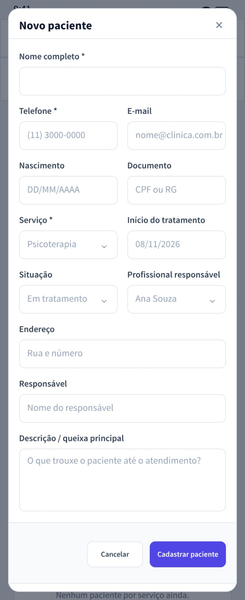

# Guia 09 — Novo Paciente (componente modal reutilizável) — Expo + React Native

**Projeto:** Clínica Psi — Prontuário para Psicólogos
**Arquivo de referência:** `novo-paciente-mobile.png` (nesta mesma pasta)
**Objetivo desta fase:** transformar o formulário "Novo paciente" em **um componente** (`src/componentes/NovoPacienteModal.tsx`) em vez de uma tela solta — vai ser usado pelo Painel (Tela 4) e pela lista de **Pacientes** (futura).

**Pré-requisito:** a árvore do app deve ter `<SafeAreaProvider>` envolvendo a raiz — isso garante que `useSafeAreaInsets()` funcione no modal. Se você ainda não passou pelo **Guia 08 (barras do sistema)**, aplique antes (G08 garante o provider); sem ele, `insets.top`/`insets.bottom` retornam zero e o shell do modal fica mal posicionado.

---

## 0. A decisão — por que componente, não tela?

|Opção|Vantagens|Desvantagens|
|---|---|---|
|Tela própria `NovoPacienteScreen` + rota|Simples no início|Muito acoplamento: toda rota daria duplicata de código; dados não migram entre chamadas|
|**Componente modal (`<NovoPacienteModal />`)**|**Uma vez só**, serve ao Painel e à lista de Pacientes; overlay nativo Android/iOS sem biblioteca|Precisa de prop `visible` e `onClose`; o pai controla "abre/fecha"|

O mesmo padrão controla outros fluxos rápidos ("Novo paciente", "Nova sessão") no futuro.

---

## 1. O mock — o que ele transmite



- Título `Novo paciente` à esquerda + `×` de fechar à direita
- Formulário em coluna única; seções agrupadas em **linha dupla** nos campos curtos:
  - Nome completo * completo
  - Telefone * · E-mail
  - Nascimento · Documento
  - Serviço * · Início do tratamento
  - Situação · Profissional responsável
  - Endereço
  - Responsável
  - Descrição / queixa principal
- Rodapé fixo na base do shell: `Cancelar` (neutro, largura automática) à esquerda + `Cadastrar paciente` (indigo, largura automática) à direita do **grupo centralizado**, gap de 16px
- **Overlayes** sobre um fundo escuro semi-transparente (a tela de fundo aparece por trás, fora de foco)

---

## 2. Anatomia do componente

```text
NovoPacienteModal (modal nativo RN)
├── BackdropView           (dim, por cima de tudo, tapping ignora)
└── SheetView              (o "cartão" branco, width 100%, altura quase total)
    ├── HeaderView         (título + botão ×)
    ├── ScrollView (conteúdo scrolls)
    │   ├── FormFields…
    │   │   ├── Nome completo *
    │   │   ├── Row [Telefone *][E-mail]
    │   │   ├── Row [Nascimento][Documento]
    │   │   ├── Row [Serviço *][Início]
    │   │   ├── Row [Situação][Profissional]
    │   │   ├── Endereço
    │   │   ├── Responsável
    │   │   └── Descrição / queixa principal
    │   └──
    └── FooterView         (rodapé: grupo centralizado Cancelar | Cadastrar paciente, gap 16px, largura automática)
```

---

## 3. O código completo — `src/componentes/NovoPacienteModal.tsx`

```tsx
// src/componentes/NovoPacienteModal.tsx
import { useCallback, useMemo, useState } from 'react';
import {
  ActivityIndicator,
  Alert,
  Keyboard,
  Modal,
  ScrollView,
  Text,
  TextInput,
  TouchableOpacity,
  View,
  StyleSheet,
} from 'react-native';
import { Ionicons } from '@expo/vector-icons';
import { useSafeAreaInsets } from 'react-native-safe-area-context';
import { colors } from '../theme';
import FormField from './FormField';

// Catálogo para os dropdowns (sem backend nesta fase)
const SERVICES = ['Psicoterapia', 'Avaliação', 'Acompanhamento'];
const SITUACOES = ['Em tratamento', 'Pausado', 'Alta'];
const PROFESSIONALS = ['Ana Souza', 'Marcos Lima', 'Clínica Psi'];
const DEFAULT_DATE = '08/11/2026';

const FieldRow = ({ children }: { children: React.ReactNode }) => (
  <View style={styles.fieldRow}>{children}</View>
);

const PickerRow = ({ label, required, value, onPress }: {
  label: string; required?: boolean; value: string; onPress: () => void;
}) => (
  <View style={styles.fieldCol}>
    <Text style={styles.label}>{label}{required ? <Text style={styles.req}> *</Text> : null}</Text>
    <TouchableOpacity style={styles.picker} onPress={onPress} accessibilityRole="button" accessibilityLabel={`Selecionar ${label}: ${value}`}>
      <Text style={styles.pickerText} numberOfLines={1}>{value}</Text>
      <Ionicons name="chevron-down-outline" size={16} color={colors.textMuted} />
    </TouchableOpacity>
  </View>
);

export type NovoPacientePayload = {
  nome: string;
  telefone: string;
  email: string;
  nascimento: string;
  documento: string;
  servico: string;
  inicio: string;
  situacao: string;
  profissional: string;
  endereco: string;
  responsavel: string;
  descricao: string;
};

type Props = {
  visible: boolean;
  onClose: () => void;
  onSaved?: (payload: NovoPacientePayload) => void;
};

export default function NovoPacienteModal({ visible, onClose, onSaved }: Props) {
  const insets = useSafeAreaInsets();
  const [nome, setNome]           = useState('');
  const [telefone, setTelefone]   = useState('');
  const [email, setEmail]         = useState('');
  const [nascimento, setNascimento]= useState('');
  const [documento, setDocumento] = useState('');
  const [servico, setServico]     = useState(SERVICES[0]);
  const [inicio, setInicio]       = useState(DEFAULT_DATE);
  const [situacao, setSituacao]   = useState(SITUACOES[0]);
  const [profissional, setProfissional] = useState(PROFESSIONALS[0]);
  const [endereco, setEndereco]   = useState('');
  const [responsavel, setResponsavel] = useState('');
  const [descricao, setDescricao] = useState('');
  const [saving, setSaving]       = useState(false);
  const [error, setError]         = useState<string | null>(null);

  const reset = useCallback(() => {
    setNome(''); setTelefone(''); setEmail(''); setNascimento(''); setDocumento('');
    setServico(SERVICES[0]); setInicio(DEFAULT_DATE); setSituacao(SITUACOES[0]); setProfissional(PROFESSIONALS[0]);
    setEndereco(''); setResponsavel(''); setDescricao(''); setError(null); setSaving(false);
  }, []);

  const close = useCallback(() => {
    reset();
    onClose();
  }, [onClose, reset]);

  const handleSubmit = useCallback(() => {
    if (!nome.trim())              { setError('Informe o nome completo.'); return; }
    if (!telefone.trim())          { setError('Informe um telefone de contato.'); return; }
    if (!servico.trim())           { setError('Selecione o serviço.'); return; }

    Keyboard.dismiss();
    setError(null);
    setSaving(true);

    const payload: NovoPacientePayload = {
      nome: nome.trim(), telefone: telefone.trim(), email: email.trim(),
      nascimento: nascimento.trim(), documento: documento.trim(),
      servico, inicio, situacao, profissional,
      endereco: endereco.trim(), responsavel: responsavel.trim(), descricao: descricao.trim(),
    };

    if (onSaved) {
      onSaved(payload);
      close();
      return;
    }

    // Standalone: sem pai controlando, mostra o sucesso localmente
    setSaving(false);
    Alert.alert('Paciente cadastrado', 'Já aparece para o seu atendimento.', [{ text: 'OK', onPress: close }]);
  }, [nome, telefone, servico, inicio, situacao, profissional, email, nascimento, documento, endereco, responsavel, descricao, onSaved, close]);

  return (
    <Modal
      visible={visible}
      animationType="slide"
      transparent
      onRequestClose={close}
      statusBarTranslucent
    >
      <View style={[styles.backdrop, { paddingTop: insets.top }]} accessibilityViewIsModal>
        <View style={styles.sheet}>
          {/* Header */}
          <View style={styles.header}>
            <Text style={styles.title}>Novo paciente</Text>
            <TouchableOpacity onPress={close} style={styles.close}
              accessibilityLabel="Fechar" accessibilityRole="button" accessibilityHint="Fecha o formulário sem salvar">
              <Text style={styles.closeText}>×</Text>
            </TouchableOpacity>
          </View>

          {/* Scrollable content */}
          <ScrollView
            contentContainerStyle={styles.scrollContent}
            keyboardShouldPersistTaps="handled"
            showsVerticalScrollIndicator={false}
          >
            <FormField
              label="Nome completo"
              required
              placeholder="Como o paciente deve aparecer no sistema"
              value={nome}
              onChangeText={(t) => { setNome(t); if (error) setError(null); }}
              autoCapitalize="words"
              maxLength={80}
              returnKeyType="next"
            />

            <FieldRow>
              <View style={styles.fieldCol}>
                <FormField
                  label="Telefone"
                  required
                  placeholder="(11) 3000-0000"
                  value={telefone}
                  onChangeText={(t) => { setTelefone(t); if (error) setError(null); }}
                  keyboardType="phone-pad"
                  maxLength={16}
                  returnKeyType="next"
                />
              </View>
              <View style={styles.fieldCol}>
                <FormField
                  label="E-mail"
                  placeholder="nome@clinica.com.br"
                  value={email}
                  onChangeText={setEmail}
                  keyboardType="email-address"
                  autoCapitalize="none"
                  autoCorrect={false}
                  maxLength={80}
                  returnKeyType="next"
                />
              </View>
            </FieldRow>

            <FieldRow>
              <View style={styles.fieldCol}>
                <FormField
                  label="Nascimento"
                  placeholder="DD/MM/AAAA"
                  value={nascimento}
                  onChangeText={setNascimento}
                  keyboardType="number-pad"
                  maxLength={10}
                  returnKeyType="next"
                />
              </View>
              <View style={styles.fieldCol}>
                <FormField
                  label="Documento"
                  placeholder="CPF ou RG"
                  value={documento}
                  onChangeText={setDocumento}
                  autoCorrect={false}
                  maxLength={20}
                  returnKeyType="next"
                />
              </View>
            </FieldRow>

            <FieldRow>
              <PickerRow label="Serviço" required value={servico} onPress={() => {
                const next = SERVICES[(SERVICES.indexOf(servico) + 1) % SERVICES.length];
                setServico(next);
              }} />
              <View style={styles.fieldCol}>
                <FormField
                  label="Início do tratamento"
                  value={inicio}
                  onChangeText={setInicio}
                  keyboardType="number-pad"
                  maxLength={10}
                  returnKeyType="next"
                />
              </View>
            </FieldRow>

            <FieldRow>
              <PickerRow label="Situação" value={situacao} onPress={() => {
                const next = SITUACOES[(SITUACOES.indexOf(situacao) + 1) % SITUACOES.length];
                setSituacao(next);
              }} />
              <PickerRow label="Profissional responsável" value={profissional} onPress={() => {
                const next = PROFESSIONALS[(PROFESSIONALS.indexOf(profissional) + 1) % PROFESSIONALS.length];
                setProfissional(next);
              }} />
            </FieldRow>

            <FormField
              label="Endereço"
              placeholder="Rua e número"
              value={endereco}
              onChangeText={setEndereco}
              maxLength={160}
              returnKeyType="next"
            />

            <FormField
              label="Responsável"
              placeholder="Nome do responsável"
              value={responsavel}
              onChangeText={setResponsavel}
              autoCapitalize="words"
              maxLength={80}
              returnKeyType="next"
            />

            <View style={styles.descriptionWrap}>
              <Text style={styles.label}>Descrição / queixa principal</Text>
              <TextInput
                style={styles.multiline}
                placeholder="O que trouxe o paciente até o atendimento?"
                placeholderTextColor={colors.placeholder}
                value={descricao}
                onChangeText={setDescricao}
                multiline
                textAlignVertical="top"
                maxLength={500}
              />
            </View>

            {error ? (
              <View style={styles.errorBox} accessibilityLiveRegion="polite">
                <Ionicons name="alert-circle-outline" size={16} color={colors.error} />
                <Text style={styles.errorText}>{error}</Text>
              </View>
            ) : null}
          </ScrollView>

          {/* Footer — respeito à área do sistema (nav bar do Android) */}
          <View style={[styles.footer, { paddingBottom: Math.max(18, insets.bottom + 12) }]}>
            <TouchableOpacity
              style={styles.buttonSecondary}
              onPress={close}
              accessibilityRole="button"
              accessibilityLabel="Cancelar"
            >
              <Text style={styles.buttonSecondaryText}>Cancelar</Text>
            </TouchableOpacity>
            <TouchableOpacity
              style={styles.buttonPrimary}
              onPress={handleSubmit}
              activeOpacity={0.85}
              disabled={saving}
              accessibilityRole="button"
              accessibilityLabel="Cadastrar paciente"
              accessibilityHint="Cadastra o paciente e fecha o formulário"
            >
              {saving ? <ActivityIndicator color="#FFFFFF" /> : <Text style={styles.buttonPrimaryText}>Cadastrar paciente</Text>}
            </TouchableOpacity>
          </View>
        </View>
      </View>
    </Modal>
  );
}

const styles = StyleSheet.create({
  backdrop: {
    flex: 1,
    backgroundColor: 'rgba(15, 23, 42, 0.48)',
    justifyContent: 'flex-end',
    alignItems: 'center',
  },
  sheet: {
    width: '100%',
    maxWidth: 480,
    backgroundColor: colors.surface,
    borderTopLeftRadius: 16,
    borderTopRightRadius: 16,
    overflow: 'hidden',
    maxHeight: '96%',
  },
  header: {
    flexDirection: 'row',
    alignItems: 'center',
    justifyContent: 'space-between',
    paddingHorizontal: 18,
    paddingVertical: 12,
    borderBottomWidth: 1,
    borderBottomColor: colors.border,
  },
  title: { fontSize: 16, fontWeight: '700', color: colors.text },
  close: {
    width: 32, height: 32, alignItems: 'center', justifyContent: 'center',
    borderRadius: 6,
  },
  closeText: { fontSize: 24, lineHeight: 26, color: colors.textMuted, fontWeight: '500' },
  scrollContent: {
    paddingHorizontal: 18,
    paddingTop: 12,
    paddingBottom: 12,
  },
  fieldRow: {
    flexDirection: 'row',
    gap: 12,
    alignItems: 'flex-start',
  },
  fieldCol: { flex: 1, minWidth: 0, marginBottom: 12 },
  label: { fontSize: 13, fontWeight: '600', color: colors.label, marginBottom: 6 },
  req: { color: colors.primary },
  picker: {
    height: 48, borderRadius: 8,
    borderWidth: 1, borderColor: colors.border,
    backgroundColor: colors.surface,
    paddingHorizontal: 14,
    flexDirection: 'row',
    alignItems: 'center',
    justifyContent: 'space-between',
  },
  pickerText: { fontSize: 15, color: colors.text, flexShrink: 1 },
  descriptionWrap: { marginBottom: 4 },
  multiline: {
    minHeight: 96, borderRadius: 8,
    borderWidth: 1, borderColor: colors.border,
    backgroundColor: colors.surface,
    paddingHorizontal: 14, paddingVertical: 10,
    fontSize: 15, color: colors.text,
  },
  errorBox: {
    flexDirection: 'row', alignItems: 'center', gap: 6,
    backgroundColor: colors.errorBg, borderRadius: 8,
    paddingHorizontal: 10, paddingVertical: 8, marginTop: 4, width: '100%',
  },
  errorText: { color: colors.error, fontSize: 13, flexShrink: 1, flex: 1 },
  footer: {
    flexDirection: 'row',
    alignItems: 'center',
    gap: 16,
    justifyContent: 'center',
    paddingHorizontal: 18,
    paddingTop: 10,
    paddingBottom: 14,          // o cálculo dinâmico está no style inline (acima) pelo insets.bottom
    borderTopWidth: 1,
    borderTopColor: colors.border,
    backgroundColor: colors.surface,  // fundo do rodapé sempre opaco (não deixa o conteúdo vazar)
  },
  buttonSecondary: {
    height: 44, borderRadius: 8,
    borderWidth: 1, borderColor: colors.border,
    paddingHorizontal: 16, alignItems: 'center', justifyContent: 'center',
  },
  buttonSecondaryText: { fontSize: 14, fontWeight: '600', color: '#334155' },
  buttonPrimary: {
    height: 44, borderRadius: 8,
    backgroundColor: colors.primary,
    paddingHorizontal: 20,
    alignItems: 'center', justifyContent: 'center',
  },
  buttonPrimaryText: { color: '#FFFFFF', fontSize: 14, fontWeight: '700' },
});
```

> **Por que `Modal` ao invés de `View` absoluta?** O `Modal` nativo faz z-index real (fica acima do StatusBar) no Android/iPhone, e consome `onRequestClose` (o botão Voltar do Android já fecha). Sem precisar disputar por posição e camadas.

> **Auto-collapse do picker para simplificar a fase:** aqui os dropdowns são ciclo-por-pressão (toca uma vez, muda para a próxima opção) — ainda sem abrir um menu suspenso. É o suficiente para o mock + interação imediata no Expo Go. Na próxima fase (serviços/agenda reais), trocamos por `@react-native-picker/picker`.

---

## 4. Ligando no Painel (Tela 4) — os dois botões virão a abrir o modal

### 4.1 Imports + estado

Substitua os imports (o `NovoPacienteModal` novo passa a ser importado e o `PrimaryButton` continua usado nas telas anteriores; aqui o rodapé do modal usa dois `TouchableOpacity` com largura automática) e adicione o estado:

```tsx
import NovoPacienteModal from '../componentes/NovoPacienteModal';

// dentro do componente PainelScreen:
const [novoPacienteOpen, setNovoPacienteOpen] = useState(false);
```

### 4.2 Substituir os `onPress`/`emBreve` pelo `setNovoPacienteOpen`

No bloco do botão `+ Novo Paciente` (toolbar, linha 315) e no bloco do hero `+ Novo paciente` (linha do fluxo de vazio), altere:

```tsx
// antes
onPress={emBreve}
// depois
onPress={() => setNovoPacienteOpen(true)}
```

Os outros `emBreve` (`☰`, `Abrir agenda`) continuam para não gigantesco nada funcional antes de existir dado.

### 4.3 Adicionar o `<NovoPacienteModal />` na raiz da tela

Logo antes do `</AppScreen>`, ou seja, como filho direto:

```tsx
      {/* Painel vazio segue igual: toolbar, headerRow, EmptyHero, SectionCards... */}

      <NovoPacienteModal
        visible={novoPacienteOpen}
        onClose={() => setNovoPacienteOpen(false)}
        onSaved={() => setNovoPacienteOpen(false)}
      />
    </AppScreen>
```

> **Por que controlar `visible` pelo pai e não do próprio modal?** Esse é o contrato de reutilização: o pai decide quando abrir. Na lista de Pacientes (futura), o botão `+ Novo Paciente` terá o mesmo 3 linhas de código; o modal já resolve submit/error/callback.

### 4.4 `src/screens/PainelScreen.tsx` — arquivo completo (para quem vai substituir o arquivo inteiro)

Se você prefere copiar o arquivo inteiro de uma vez (e não remontar os passos §4.1–§4.3), aqui está o `PainelScreen.tsx` corrigido, já com `NovoPacienteModal`, `useState` e os dois botões:

```tsx
// src/screens/PainelScreen.tsx
import { useState } from 'react';
import { Alert, View, Text, TextInput, TouchableOpacity, StyleSheet } from 'react-native';
import { colors } from '../theme';
import AppScreen from '../componentes/AppScreen';
import SectionCard from '../componentes/SectionCard';
import EmptyHero from '../componentes/EmptyHero';
import NovoPacienteModal from '../componentes/NovoPacienteModal';

const emBreve = () =>
  Alert.alert('Em breve', 'Nesta fase, os dados aparecem só depois que a persistência for conectada.', [{ text: 'Entendi' }]);

export default function PainelScreen() {
  const [novoPacienteOpen, setNovoPacienteOpen] = useState(false);

  return (
    <AppScreen>
      {/* Toolbar (☰ + busca) */}
      <View style={styles.toolbar}>
        <TouchableOpacity
          style={styles.menuBtn}
          onPress={() => Alert.alert('Menu', 'O menu lateral entra quando a navegação global estiver ligada.', [{ text: 'Entendi' }])}
          accessibilityRole="button"
          accessibilityLabel="Abrir menu"
        >
          <Text style={styles.menuIcon}>☰</Text>
        </TouchableOpacity>
        <TextInput
          style={styles.search}
          placeholder="⌕ Buscar paciente pelo nome ou telefone…"
          placeholderTextColor={colors.placeholder}
          editable={false}
          accessibilityLabel="Buscar paciente"
        />
      </View>

      {/* Linha de título + ação */}
      <View style={styles.headerRow}>
        <View>
          <Text style={styles.title}>Painel</Text>
          <Text style={styles.subtitle}>Visão geral da clínica</Text>
        </View>
        <TouchableOpacity
          style={styles.newPatientBtn}
          onPress={() => setNovoPacienteOpen(true)}
          accessibilityRole="button"
          accessibilityLabel="Novo Paciente"
        >
          <Text style={styles.newPatientText}>+ Novo Paciente</Text>
        </TouchableOpacity>
      </View>

      {/* Hero estado vazio */}
      <EmptyHero onPress={() => setNovoPacienteOpen(true)} />

      {/* Sessões de hoje */}
      <SectionCard title="Sessões de hoje" actionLabel="Abrir agenda" onActionPress={emBreve}>
        <Text style={styles.muted}>Nenhuma sessão agendada para hoje.</Text>
      </SectionCard>

      {/* Últimos registros */}
      <SectionCard title="Últimos registros">
        <Text style={styles.muted}>Nenhuma evolução registrada.</Text>
      </SectionCard>

      {/* Pacientes por serviço */}
      <SectionCard title="Pacientes por serviço">
        <Text style={styles.muted}>Nenhum paciente por serviço ainda.</Text>
      </SectionCard>

      {/* Modal Novo Paciente */}
      <NovoPacienteModal
        visible={novoPacienteOpen}
        onClose={() => setNovoPacienteOpen(false)}
        onSaved={() => setNovoPacienteOpen(false)}
      />
    </AppScreen>
  );
}

const styles = StyleSheet.create({
  toolbar: {
    flexDirection: 'row',
    alignItems: 'center',
    gap: 10,
    paddingTop: 10,
    paddingBottom: 10,
    borderBottomWidth: 1,
    borderBottomColor: colors.border,
    backgroundColor: colors.surface,
    marginHorizontal: -16,
    paddingHorizontal: 16,
  },
  menuBtn: {
    width: 42, height: 42, borderRadius: 8,
    borderWidth: 1, borderColor: colors.border,
    backgroundColor: colors.surface,
    alignItems: 'center', justifyContent: 'center',
  },
  menuIcon: { fontSize: 18, color: colors.text },
  search: {
    flex: 1, height: 42, borderRadius: 8,
    borderWidth: 1, borderColor: colors.border,
    backgroundColor: colors.surface,
    paddingHorizontal: 12, fontSize: 13, color: colors.placeholder,
  },
  headerRow: {
    flexDirection: 'row',
    alignItems: 'center',
    justifyContent: 'space-between',
    paddingTop: 12,
    paddingBottom: 4,
  },
  title: { fontSize: 20, fontWeight: '800', color: colors.text },
  subtitle: { fontSize: 13, color: colors.textMuted, marginTop: 2 },
  newPatientBtn: {
    height: 40,
    paddingHorizontal: 14,
    borderRadius: 8,
    backgroundColor: colors.primary,
    alignItems: 'center', justifyContent: 'center',
  },
  newPatientText: { color: '#FFFFFF', fontSize: 13, fontWeight: '700' },
  muted: { fontSize: 13, color: colors.textMuted, textAlign: 'center' },
});
```

**`App.js` não muda.** Nenhum outro arquivo muda.

---

## 5. Delta visual

```diff
 // src/screens/PainelScreen.tsx
 import AppScreen from '../componentes/AppScreen';
 import SectionCard from '../componentes/SectionCard';
 import EmptyHero from '../componentes/EmptyHero';
+import NovoPacienteModal from '../componentes/NovoPacienteModal';

 export default function PainelScreen() {
+  const [novoPacienteOpen, setNovoPacienteOpen] = useState(false);
...
-           onPress={emBreve}
+           onPress={() => setNovoPacienteOpen(true)}     // botão na toolbar
...
-      <EmptyHero onPress={emBreve} />
+      <EmptyHero onPress={() => setNovoPacienteOpen(true)} />   // CTA do hero
...
+      <NovoPacienteModal
+        visible={novoPacienteOpen}
+        onClose={() => setNovoPacienteOpen(false)}
+        onSaved={() => setNovoPacienteOpen(false)}
+      />
     </AppScreen>
   );
 }
```

---

## 6. O que isso vem a ser?

- Um `Modal` cujo `visible` é passado pelo pai — o controlador do modal recebe `visible`/`onClose` e opcionalmente `onSaved(payload)`
- `handleSubmit` interno faz a validação local (nome, telefone, serviço); botões externos não são necessários
- Os dois botões do rodapé são `TouchableOpacity` locais (sem `PrimaryButton`/`full-width`) — largura baseada no texto, altura uniforme 44dp, centralizados; `gap: 16`
- O `<FormField>` nunca muda — apenas recebe `value`/`onChangeText`
- A responsabilidade do `NovoPacientePayload` é só transportar os dados; a persistência (e até a navegação pós-cadastro) são do pai

## 7. Sugestão de interações secundárias (sem código)

```
BackPress / Voltar (Android)  →  onRequestClose do Modal → aciona close()
Cancelar                      →  onPress=close
```

---

## 8. Checklist de aceite (contra `novo-paciente-mobile.png`)

**Visual**
- [ ] Fundo escurecido por trás (backdrop)
- [ ] Sheet branco na parte de baixo, borda arredondada só em cima
- [ ] Header: `Novo paciente` à esquerda, `×` à direita
- [ ] Nome completo * (linha inteira)
- [ ] Telefone * | E-mail (mesma linha)
- [ ] Nascimento | Documento
- [ ] Serviço * | Início do tratamento
- [ ] Situação | Profissional responsável
- [ ] Endereço (linha inteira)
- [ ] Responsável (linha inteira)
- [ ] Descrição / queixa principal (textarea)
- [ ] Footer: `Cancelar` e `Cadastrar paciente` — grupo centralizado, gap uniforme 16px, largura baseada no conteúdo, sem esticar nenhuma direção
- [ ] Header: `Novo paciente` à esquerda, `×` à direita — não sobrepõe o status bar

**Funcional**
- [ ] Ao pressionar o botão da toolbar ou do hero na tela Painel → abre o modal
- [ ] Validação bloqueia submit sem nome/telefone/serviço
- [ ] `×` e `Cancelar` fecham sem salvar (e resetam o formulário)
- [ ] Android Voltar (`onRequestClose`) fecha o modal (não o app)
- [ ] Cliente valida pelo backdrop: nada reage ao tocar o fundo (para não perder dados por acidente)
- [ ] Mensagem de sucesso (quando standalone) ou navegação para a lista futura (quando `onSaved` estiver nos pais corretos)

**Integração**
- [ ] `FormField` nunca layout-explode quando 2 campos ficam na mesma linha (flex: 1 + gap: 12)
- [ ] `Responsiveness`: sheet ocupa 100% da largura até 480dp; acima disso, fixo em 480dp com centralização

---

## 9. Troubleshooting direto

- **Label `Serviço` quebra vertical (S → e → r →…)**: é sintoma de largura colapsada de flex. Com `fieldCol = { flex: 1, minWidth: 0, marginBottom: 12 }` e sem `width:'100%'` no utilitário externo, isso não acontece; reduza o `gap` da linha se um aparelho de 320dp continuar apertando
- **Primeira coluna some / segunda invade direita**: o wrapper externo do `<FormField>` não pode ter `width: '100%'` fixo. Este guia usa `fieldCol` apenas com `flex: 1, minWidth: 0`
- **Entrada de Início do tratamento ocupa o espaço todo**: mesmo bug da linha do Flex — substituição por `fieldCol`
- **Footer encostado na barra de navegação do Android**: esse é o problema clássico do Android edge-to-edge — o `react-native-safe-area-context` está no Expo Go por padrão (`SafeAreaProvider` no `App.js`, `useSafeAreaInsets()` em todos os componentes que precisam), então `insets.bottom` devolve exatamente a altura da barra 3-botão / gestos. Use no rodapé do modal: `paddingBottom: Math.max(18, insets.bottom + 12)` e `paddingTop: insets.top` no backdrop para o header não encostar no status bar
- **SafeAreaInsets returns 0/0/0/0 no emulador**: no emulador Android geralmente retorna insets válidos (a barra aparece), mas pode retornar zero no Snack Web — só validar em device físico ou emulador Android com 3 botões/gestos
- **Header do modal encostado no status bar**: o backdrop herda `paddingTop: insets.top`; sem isso, o cabeçalho `Novo paciente` pode ficar por cima do relógio no edge-to-edge
- **Nav bar do Samsung**: a cor é do sistema, não do app; o Samsung decide (geralmente preto/branco conforme o tema) e o nosso rodapé com fundo `colors.surface` mantém contraste
- **Sumir completamente com a barra do sistema**: `expo-navigation-bar` tem `setHidden(true)`, mas é decisão de UX, não necessidade; o `useSafeAreaInsets` já resolve o problema real
- **`Cadastrar paciente` esticado/centralizado errado**: é sintoma de herança de `width: '100%'` do `PrimaryButton` (full-width). Aqui o botão principal é TouchableOpacity local com `paddingHorizontal: 20` e sem `width`; silencioso, o flex-row do rodapé + `justifyContent: 'center'` + `gap: 16` centraliza o par automaticamente

---

## 9.1 O caso da coluna colapsada — o padrão correto para linha com 2 filhos

Este é o padrão fixo aplicado em todas as linhas de 2 campos (Telefone+E-mail / Nascimento+Documento / Serviço+Início / Situação+Profissional):

```tsx
<FieldRow>
  <View style={styles.fieldCol}>
    <FormField … />
  </View>
  <View style={styles.fieldCol}>
    <FormField … />
  </View>
</FieldRow>
```

E o `styles.fieldCol` compartilhado:

```tsx
fieldCol: { flex: 1, minWidth: 0, marginBottom: 12 }
```

Motivo em duas linhas:
1. `flex: 1` distribui igualmente → 50% para cada campo
2. `minWidth: 0` evita que um campo com conteúdo maior force o coeficiente a zero (ver a seção a seguir sobre `<FormField>`)

**Regra mental**: em uma linha com N filhos, o wrapper `styles.fieldRow` define a direção; cada filho define seu próprio `flex: 1`; nenhum deles usa `width: '100%'`.

---

## 10. O que ainda NÃO entra aqui

- `Ya existe pacientes reais no estado da árvore`
- Serviços reais vindos de `services/` — são listas hardcoded na fase
- `SQLite` e callbacks de criação (vira integração no auth)
- Exclusão/edição do paciente — este formulário é **criar**
