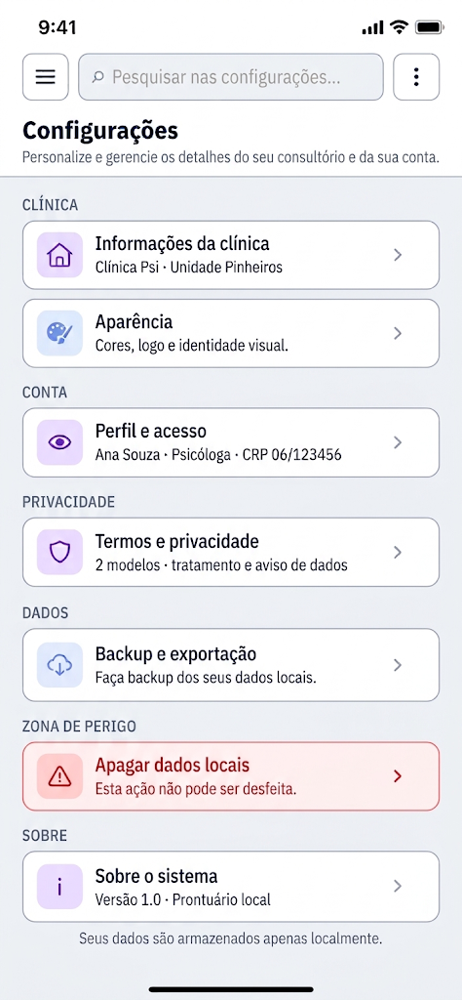

O Guia 14 (**Configurações**) segue exatamente o mesmo padrão arquitetural e de design das telas anteriores (como Agenda e Serviços), utilizando os componentes compartilhados do projeto (como `AppScreen`, `AppToolbar` e `AppDrawer`).

**Imagem de referência:** `configuracoes-mobile.png` (nesta mesma pasta)

Como a imagem de referência mostra a tela de Configurações com opções divididas em blocos (*Clínica, Conta, Privacidade, Dados, Zona de Perigo e Sobre*), estruturei o código completo do componente para você criar o arquivo `src/screens/ConfiguracoesScreen.tsx` e atualizar o fluxo de navegação do aplicativo.

---

### 1. O código da nova tela: `src/screens/ConfiguracoesScreen.tsx`

Crie o arquivo `src/screens/ConfiguracoesScreen.tsx` com o seguinte conteúdo:

```tsx
// src/screens/ConfiguracoesScreen.tsx
import { useMemo, useState } from 'react';
import { Alert, ScrollView, Text, TouchableOpacity, View, StyleSheet } from 'react-native';
import { Ionicons } from '@expo/vector-icons';

import { colors } from '../theme';
import AppScreen from '../componentes/AppScreen';
import AppToolbar from '../componentes/AppToolbar';
import AppDrawer from '../componentes/AppDrawer';
import type { DrawerItem } from '../componentes/AppDrawer';

export default function ConfiguracoesScreen(
  { onNavegar }: { onNavegar: (to: 'painel' | 'pacientes' | 'agenda' | 'servicos' | 'configuracoes') => void } = { onNavegar: () => {} }
) {
  const [drawerOpen, setDrawerOpen] = useState(false);
  const [search, setSearch] = useState('');

  const drawerItems: DrawerItem[] = useMemo(
    () => [
      { key: 'painel',        label: 'Painel',        icon: 'grid-outline',      onPress: () => onNavegar('painel') },
      { key: 'pacientes',     label: 'Pacientes',     icon: 'people-outline',    onPress: () => onNavegar('pacientes') },
      { key: 'agenda',        label: 'Agenda',        icon: 'calendar-outline',  onPress: () => onNavegar('agenda') },
      { key: 'servicos',      label: 'Serviços',      icon: 'medkit-outline',    onPress: () => onNavegar('servicos') },
      { key: 'configuracoes', label: 'Configurações', icon: 'settings-outline', active: true, onPress: () => onNavegar('configuracoes') },
    ],
    [onNavegar]
  );

  const emBreve = (titulo: string, mensagem: string) =>
    Alert.alert(titulo, mensagem, [{ text: 'Entendi' }]);

  return (
    <AppScreen>
      {/* Barra superior (☰ + busca + ⋮) */}
      <AppToolbar
        onMenuPress={() => setDrawerOpen(true)}
        search={search}
        onChangeSearch={setSearch}
        placeholder="Pesquisar nas configurações..."
        rightActionIcon="ellipsis-vertical"
        onRightActionPress={() => emBreve('Configurações', 'Opções gerais do sistema entram na próxima fase.')}
        rightActionLabel="Mais ações"
      />

      <ScrollView contentContainerStyle={styles.scrollContainer} showsVerticalScrollIndicator={false}>
        {/* Título + Subtítulo */}
        <View style={styles.headerArea}>
          <Text style={styles.title}>Configurações</Text>
          <Text style={styles.subtitle}>Personalize e gerencie os detalhes do seu consultório e da sua conta.</Text>
        </View>

        {/* Seção: CLÍNICA */}
        <Text style={styles.sectionHeader}>CLÍNICA</Text>
        <View style={styles.sectionGroup}>
          <TouchableOpacity 
            style={styles.cardItem} 
            onPress={() => emBreve('Informações da clínica', 'O gerenciamento da unidade entra na próxima fase.')}
            accessibilityRole="button"
          >
            <View style={[styles.cardIconWrap, { backgroundColor: '#EDE9FE' }]}>
              <Ionicons name="business-outline" size={20} color="#7C3AED" />
            </View>
            <View style={styles.cardContent}>
              <Text style={styles.cardTitle}>Informações da clínica</Text>
              <Text style={styles.cardSubtitle}>Clínica Psi · Unidade Pinheiros</Text>
            </View>
            <Ionicons name="chevron-forward" size={18} color={colors.textMuted} />
          </TouchableOpacity>

          <View style={styles.separator} />

          <TouchableOpacity 
            style={styles.cardItem} 
            onPress={() => emBreve('Aparência', 'A personalização de cores e tema entra na próxima fase.')}
            accessibilityRole="button"
          >
            <View style={[styles.cardIconWrap, { backgroundColor: '#EDE9FE' }]}>
              <Ionicons name="color-palette-outline" size={20} color="#7C3AED" />
            </View>
            <View style={styles.cardContent}>
              <Text style={styles.cardTitle}>Aparência</Text>
              <Text style={styles.cardSubtitle}>Cores, logo e identidade visual.</Text>
            </View>
            <Ionicons name="chevron-forward" size={18} color={colors.textMuted} />
          </TouchableOpacity>
        </View>

        {/* Seção: CONTA */}
        <Text style={styles.sectionHeader}>CONTA</Text>
        <View style={styles.sectionGroup}>
          <TouchableOpacity 
            style={styles.cardItem} 
            onPress={() => emBreve('Perfil e acesso', 'A edição de perfil profissional entra na próxima fase.')}
            accessibilityRole="button"
          >
            <View style={[styles.cardIconWrap, { backgroundColor: '#EDE9FE' }]}>
              <Ionicons name="eye-outline" size={20} color="#7C3AED" />
            </View>
            <View style={styles.cardContent}>
              <Text style={styles.cardTitle}>Perfil e acesso</Text>
              <Text style={styles.cardSubtitle}>Ana Souza · Psicóloga · CRP 06/123456</Text>
            </View>
            <Ionicons name="chevron-forward" size={18} color={colors.textMuted} />
          </TouchableOpacity>
        </View>

        {/* Seção: PRIVACIDADE */}
        <Text style={styles.sectionHeader}>PRIVACIDADE</Text>
        <View style={styles.sectionGroup}>
          <TouchableOpacity 
            style={styles.cardItem} 
            onPress={() => emBreve('Termos e privacidade', 'A exibição de termos entra na próxima fase.')}
            accessibilityRole="button"
          >
            <View style={[styles.cardIconWrap, { backgroundColor: '#EDE9FE' }]}>
              <Ionicons name="shield-outline" size={20} color="#7C3AED" />
            </View>
            <View style={styles.cardContent}>
              <Text style={styles.cardTitle}>Termos e privacidade</Text>
              <Text style={styles.cardSubtitle}>2 modelos · tratamento e aviso de dados</Text>
            </View>
            <Ionicons name="chevron-forward" size={18} color={colors.textMuted} />
          </TouchableOpacity>
        </View>

        {/* Seção: DADOS */}
        <Text style={styles.sectionHeader}>DADOS</Text>
        <View style={styles.sectionGroup}>
          <TouchableOpacity 
            style={styles.cardItem} 
            onPress={() => emBreve('Backup e exportação', 'As ferramentas de backup entram na próxima fase.')}
            accessibilityRole="button"
          >
            <View style={[styles.cardIconWrap, { backgroundColor: '#EDE9FE' }]}>
              <Ionicons name="cloud-upload-outline" size={20} color="#7C3AED" />
            </View>
            <View style={styles.cardContent}>
              <Text style={styles.cardTitle}>Backup e exportação</Text>
              <Text style={styles.cardSubtitle}>Faça backup dos seus dados locais.</Text>
            </View>
            <Ionicons name="chevron-forward" size={18} color={colors.textMuted} />
          </TouchableOpacity>
        </View>

        {/* Seção: ZONA DE PERIGO */}
        <Text style={styles.sectionHeader}>ZONA DE PERIGO</Text>
        <View style={[styles.sectionGroup, styles.dangerGroup]}>
          <TouchableOpacity 
            style={styles.cardItem} 
            onPress={() => emBreve('Apagar dados locais', 'A ação de limpeza total requer confirmação de segurança.')}
            accessibilityRole="button"
          >
            <View style={[styles.cardIconWrap, { backgroundColor: '#FEE2E2' }]}>
              <Ionicons name="alert-circle-outline" size={20} color="#DC2626" />
            </View>
            <View style={styles.cardContent}>
              <Text style={[styles.cardTitle, { color: '#DC2626' }]}>Apagar dados locais</Text>
              <Text style={styles.cardSubtitle}>Esta ação não pode ser desfeita.</Text>
            </View>
            <Ionicons name="chevron-forward" size={18} color="#DC2626" />
          </TouchableOpacity>
        </View>

        {/* Seção: SOBRE */}
        <Text style={styles.sectionHeader}>SOBRE</Text>
        <View style={styles.sectionGroup}>
          <TouchableOpacity 
            style={styles.cardItem} 
            onPress={() => emBreve('Sobre o sistema', 'Detalhes da versão e ambiente local.')}
            accessibilityRole="button"
          >
            <View style={[styles.cardIconWrap, { backgroundColor: '#EDE9FE' }]}>
              <Ionicons name="information-circle-outline" size={20} color="#7C3AED" />
            </View>
            <View style={styles.cardContent}>
              <Text style={styles.cardTitle}>Sobre o sistema</Text>
              <Text style={styles.cardSubtitle}>Versão 1.0 · Prontuário local</Text>
            </View>
            <Ionicons name="chevron-forward" size={18} color={colors.textMuted} />
          </TouchableOpacity>
        </View>

        {/* Nota rodapé */}
        <Text style={styles.footerNote}>Seus dados são armazenados apenas localmente.</Text>
      </ScrollView>

      {/* Menu lateral */}
      <AppDrawer visible={drawerOpen} onClose={() => setDrawerOpen(false)} items={drawerItems} />
    </AppScreen>
  );
}

const styles = StyleSheet.create({
  scrollContainer: { paddingBottom: 32, paddingTop: 8 },
  headerArea: { paddingBottom: 16, borderBottomWidth: 1, borderBottomColor: colors.border, marginBottom: 16 },
  title: { fontSize: 22, fontWeight: '800', color: colors.text },
  subtitle: { fontSize: 13, color: colors.textMuted, marginTop: 4, lineHeight: 18 },
  sectionHeader: { fontSize: 11, fontWeight: '700', color: colors.textMuted, letterSpacing: 0.8, marginTop: 16, marginBottom: 8, paddingHorizontal: 4 },
  sectionGroup: {
    backgroundColor: colors.surface, borderRadius: 16, overflow: 'hidden',
    shadowColor: '#0F172A', shadowOpacity: 0.05, shadowRadius: 6,
    shadowOffset: { width: 0, height: 2 }, elevation: 2,
    borderWidth: 1, borderColor: colors.border,
  },
  dangerGroup: { borderColor: '#FCA5A5', backgroundColor: '#FFF5F5' },
  cardItem: { flexDirection: 'row', alignItems: 'center', padding: 14, gap: 12 },
  cardIconWrap: { width: 40, height: 40, borderRadius: 10, alignItems: 'center', justifyContent: 'center' },
  cardContent: { flex: 1, gap: 2 },
  cardTitle: { fontSize: 15, fontWeight: '700', color: colors.text },
  cardSubtitle: { fontSize: 12, color: colors.textMuted },
  separator: { height: 1, backgroundColor: colors.border, marginLeft: 66 },
  footerNote: { textAlign: 'center', fontSize: 12, color: colors.textMuted, marginTop: 24, fontStyle: 'italic' },
});

```

---

### 2. Atualizações nos arquivos existentes (Deltas)

Para ligar a tela de Configurações no restante do aplicativo (permitindo navegação via drawer e links), aplique os pequenos ajustes abaixo:

#### A. Atualizar as assinaturas de `onNavegar` nas telas principais

Em `PainelScreen.tsx`, `PacientesScreen.tsx`, `AgendaScreen.tsx` e `ServicosScreen.tsx`, expanda a tipagem da união para aceitar `'configuracoes'` e inclua o item ativo no array `drawerItems`:

```typescript
// Exemplo nos tipos de rota das telas:
{ onNavegar }: { onNavegar: (to: 'painel' | 'pacientes' | 'agenda' | 'servicos' | 'configuracoes') => void }

// No useMemo do drawerItems de cada tela:
{ key: 'configuracoes', label: 'Configurações', icon: 'settings-outline', onPress: () => onNavegar('configuracoes') },

```

#### B. Registrar a rota no `App.js`

Adicione o import e a renderização condicional da nova tela no arquivo principal do projeto:

```javascript
// No topo com os outros imports:
import ConfiguracoesScreen from './src/screens/ConfiguracoesScreen';

// Dentro do renderizador de rotas (junto dos outros 'else if'):
} else if (tela === 'configuracoes') {
  conteudo = <ConfiguracoesScreen onNavegar={go} />;

```