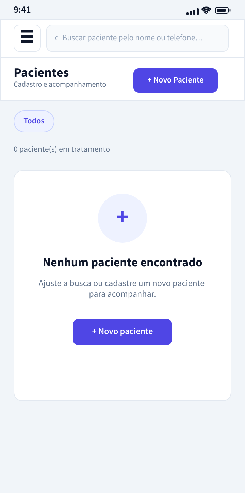

# Guia 11 — Pacientes (lista vazia) — Expo + React Native

**Projeto:** Clínica Psi — Prontuário para Psicólogos
**Estado final:** `ESTADO_FINAL_COMPLETO.md` (raiz da pasta) - snapshot completo do app com todas as mudancas desta fase aplicadas
**Arquivo de referência:** `pacientes-mobile.png` (nesta mesma pasta)
**Objetivo desta fase:** implementar a tela "Pacientes — Cadastro e acompanhamento" em estado vazio (zero pacientes), acessível a partir do menu lateral (`☰` → `Pacientes`), reutilizando o mesmo padrão da Tela 4.



---

## 0. O que muda nesta fase

| Antes | Depois |
|---|---|
| `EmptyHero` com texto fixo | `EmptyHero` **genérico** (título/subtítulo/rótulo configuráveis) |
| Toolbar em linha com o mock só no Painel (o Pacientes tinha uma versão ligeiramente diferente) | Componente compartilhado **`AppToolbar`** (mesma barra em todas as telas pós-login) |
| Roteamento em `App.js` só cobre `login/cadastro/painel` | Nova rota `pacientes` (com `onNavegar` para as telas pós-login) |
| `AppDrawer` opção "Pacientes" só fecha o menu | Item ganha `onPress` ligado ao `onNavegar('pacientes')` (Rota A) |

**Mudança mínima** em `LoginScreen`, `CadastroPasso1/2`, `NovoPacienteModal` — apenas `EmptyHero` passa a ser reutilizado pelos dois vazios, e `PainelScreen`/`PacientesScreen` ganham `onNavegar` para ligar o Drawer.

---

## 1. O mock — o que cada elemento transmite

| Elemento | Detalhe |
|---|---|
| **Status bar** | `9:41` com ícones de sinal/wifi/bateria (igual ao resto da família — `barStyle="dark-content"`) |
| **Toolbar** | `☰` à esquerda; `Buscar paciente pelo nome ou telefone…` busca no centro; fundo branco, borda sutil embaixo |
| **Linha de título** | `Pacientes` em destaque + `Cadastro e acompanhamento` (cinza, menor) — sobre a mesma faixa branca do cabeçalho, com hairline por baixo, como no mock |
| **Ação principal** | Botão `+ Novo Paciente` indigo preenchido, lado direito, mesma política visual do botão do Painel |
| **Filtro chip** | `Todos` (ativo) — o único chip por enquanto |
| **Contador** | `0 paciente(s) em tratamento` (cinza) |
| **Card vazio** | Círculo indigo claro com `+` (mesmo padrão do `EmptyHero` do Painel) |
| **Título do vazio** | `Nenhum paciente encontrado` (negrito) |
| **Descrição** | `Ajuste a busca ou cadastre um novo paciente para acompanhar.` (cinza, 2 linhas) |
| **CTA** | Botão indigo centrado com `+ Novo paciente` |
| **Rodapé** | Somente a barra de navegação nativa do sistema |

---

## 2. Refatorando `EmptyHero` (componente comum entre Painel e Pacientes)

O `EmptyHero` que você já tem (`src/componentes/EmptyHero.tsx`) tem o texto fixado para o Painel. Refatoramos para receber 3 props — e os calls que já existem continuam funcionando (defaults no Painel bate com o mock):

```tsx
// src/componentes/EmptyHero.tsx
import { View, Text, TouchableOpacity, StyleSheet } from 'react-native';
import { colors } from '../theme';

type Props = {
  title?: string;
  subtitle?: string;
  buttonLabel?: string;
  onPress?: () => void;
};

export default function EmptyHero({
  title = 'Crie seu primeiro paciente para começar',
  subtitle = 'Cadastre o primeiro paciente para acompanhar sessões, evoluções e termos LGPD em um só lugar.',
  buttonLabel = '+ Novo paciente',
  onPress,
}: Props) {
  return (
    <View style={styles.card}>
      <View style={styles.circle}><Text style={styles.plus}>+</Text></View>
      <Text style={styles.title}>{title}</Text>
      <Text style={styles.subtitle}>{subtitle}</Text>
      <TouchableOpacity style={styles.button} onPress={onPress} accessibilityRole="button" accessibilityLabel={buttonLabel}>
        <Text style={styles.buttonText}>{buttonLabel}</Text>
      </TouchableOpacity>
    </View>
  );
}

const styles = StyleSheet.create({
  card: {
    backgroundColor: colors.surface,
    borderRadius: 16,
    paddingVertical: 28,
    paddingHorizontal: 16,
    alignItems: 'center',
    gap: 12,
    marginTop: 12,
  },
  circle: {
    width: 88, height: 88, borderRadius: 44,
    backgroundColor: 'rgba(79, 70, 229, 0.16)',
    alignItems: 'center', justifyContent: 'center',
  },
  plus: { fontSize: 32, fontWeight: '400', color: '#4F46E5', marginTop: 2 },
  title: { fontSize: 19, fontWeight: '800', color: colors.text, textAlign: 'center', paddingHorizontal: 12 },
  subtitle: { fontSize: 13, color: colors.textMuted, textAlign: 'center', lineHeight: 18, paddingHorizontal: 24 },
  button: {
    height: 44, borderRadius: 8,
    paddingHorizontal: 20,
    backgroundColor: colors.primary,
    alignItems: 'center', justifyContent: 'center',
    marginTop: 4,
  },
  buttonText: { fontSize: 14, fontWeight: '700', color: '#FFFFFF' },
});
```

> Estrutura preservada (mesmo circle/plus/card); só ganhamos parâmetros opcionais. As chamadas atuais (`<EmptyHero onPress={...}/>` sem props) continuam sendo padrão Painel.

**Explicação — bloco a bloco (quem nunca viu este arquivo):**
- `type Props = { ... }` — declara o que o componente aceita de fora; tudo `?` = opcional, com default no corpo
- `title`/`subtitle`/`buttonLabel` — os textos do vazio; Painel e Pacientes passam valores diferentes, o componente não sabe qual é qual
- `onPress` — callback sem default: quem usa **precisa** passar (cada tela decide o que o botão faz)
- `<View style={styles.circle}>` + `<Text>+</Text>` — o círculo indigo claro com o plus grande, fiel ao mock
- `styles` — `gap: 12` no card (o `View` separa as linhas sozinho); `rgba(79, 70, 229, 0.16)` = indigo clareado para o círculo

---

## 3. A tela nova — `src/screens/PacientesScreen.tsx`

> **Este é o arquivo FINAL e completo da tela, com a navegação do Drawer já ligada** (o mesmo conteúdo que o §5 repete como “passo a passo” caso você prefira migrar aos poucos). Cole inteiro — não edite nada à mão.

```tsx
// src/screens/PacientesScreen.tsx
import { useState, useMemo } from 'react';
import { Alert, View, Text, TouchableOpacity, StyleSheet } from 'react-native';
import { colors } from '../theme';
import AppScreen from '../componentes/AppScreen';      // moldura "pós-login" (statusbar + scroll)
import EmptyHero from '../componentes/EmptyHero';      // vazio reutilizado (Painel e Pacientes)
import AppDrawer from '../componentes/AppDrawer';      // menu lateral (navigation por items)
import type { DrawerItem } from '../componentes/AppDrawer';
import AppToolbar from '../componentes/AppToolbar';
import NovoPacienteModal from '../componentes/NovoPacienteModal';

// A tela funciona sozinha (sem props, útil para o Snack/Expo Go) ou conectada
// pela Rota A: o App.js passa onNavegar e o Drawer troca de tela de verdade.
export default function PacientesScreen(
  { onNavegar }: { onNavegar: (to: 'painel' | 'pacientes' | 'agenda') => void } = { onNavegar: () => {} }
) {
  const [drawerOpen, setDrawerOpen] = useState(false);   // ☰ abre/fecha o menu lateral
  const [novoPacienteOpen, setNovoPacienteOpen] = useState(false); // controla o modal
  const [search, setSearch] = useState('');              // busca controlada (filtra quando houver dados)

  // Item "Painel" leva de volta ao Painel; "Pacientes" fica marcado como ativo.
  const drawerItems: DrawerItem[] = useMemo(
    () => [
      { key: 'painel',        label: 'Painel',        icon: 'grid-outline',                onPress: () => onNavegar('painel') },
      { key: 'pacientes',     label: 'Pacientes',     icon: 'people-outline', active: true, onPress: () => onNavegar('pacientes') },
      { key: 'agenda',        label: 'Agenda',        icon: 'calendar-outline',             onPress: () => onNavegar('agenda') },
      { key: 'servicos',      label: 'Serviços',      icon: 'medkit-outline' },
      { key: 'configuracoes', label: 'Configurações', icon: 'settings-outline' },
    ],
    [onNavegar]
  );

  // Ação "Em breve" desta fase: ainda sem persistência, tudo avisa com um Alert.
  const emBreve = () =>
    Alert.alert('Em breve', 'Nesta fase os dados aparecem após a persistência ser conectada.', [{ text: 'Entendi' }]);

  return (
    <AppScreen>
      {/* Barra superior (☰ + busca) — componente compartilhado */}
      <AppToolbar onMenuPress={() => setDrawerOpen(true)} search={search} onChangeSearch={setSearch} />

      {/* Linha de título + ação */}
      <View style={styles.headerRow}>
        <View>
          <Text style={styles.title}>Pacientes</Text>
          <Text style={styles.subtitle}>Cadastro e acompanhamento</Text>
        </View>
        <TouchableOpacity
          style={styles.newPatientBtn}
          onPress={() => setNovoPacienteOpen(true)}
          accessibilityRole="button"
          accessibilityLabel="Novo Paciente"
        >
          <Text style={styles.newPatientText}>+ Novo Paciente</Text>
        </TouchableOpacity>
      </View>

      {/* Chip de filtro */}
      <View style={styles.chips}>
        <TouchableOpacity style={styles.chip} onPress={emBreve} accessibilityRole="button">
          <Text style={styles.chipText}>Todos</Text>
        </TouchableOpacity>
      </View>

      {/* Contador */}
      <Text style={styles.count}>0 paciente(s) em tratamento</Text>

      {/* Estado vazio */}
      <EmptyHero
        title="Nenhum paciente encontrado"
        subtitle="Ajuste a busca ou cadastre um novo paciente para acompanhar."
        buttonLabel="+ Novo paciente"
        onPress={() => setNovoPacienteOpen(true)}
      />

      {/* Drawer */}
      <AppDrawer visible={drawerOpen} onClose={() => setDrawerOpen(false)} items={drawerItems} />

      {/* Modal Novo Paciente */}
      <NovoPacienteModal
        visible={novoPacienteOpen}
        onClose={() => setNovoPacienteOpen(false)}
        onSaved={() => setNovoPacienteOpen(false)}
      />
    </AppScreen>
  );
}

const styles = StyleSheet.create({
  headerRow: {
    flexDirection: 'row', alignItems: 'center', justifyContent: 'space-between',
    paddingTop: 12, paddingBottom: 12,
    borderBottomWidth: 1, borderBottomColor: colors.border,
    backgroundColor: colors.surface,
    marginHorizontal: -16, paddingHorizontal: 16,   // faixa branca até as bordas, como a toolbar
  },
  title: { fontSize: 20, fontWeight: '800', color: colors.text },
  subtitle: { fontSize: 13, color: colors.textMuted, marginTop: 2 },
  newPatientBtn: {
    height: 40, paddingHorizontal: 14, borderRadius: 8,
    backgroundColor: colors.primary,
    alignItems: 'center', justifyContent: 'center',
  },
  newPatientText: { color: '#FFFFFF', fontSize: 13, fontWeight: '700' },
  chips: { flexDirection: 'row', gap: 8, paddingTop: 12, paddingBottom: 6 },
  chip: {
    borderRadius: 999, paddingHorizontal: 12, paddingVertical: 8,
    borderWidth: 1, borderColor: colors.primary,
    backgroundColor: 'rgba(79, 70, 229, 0.08)',
  },
  chipText: { fontSize: 12, fontWeight: '600', color: colors.primary },
  count: { fontSize: 13, color: colors.textMuted, marginTop: 8, marginBottom: 4 },
});
```

> `Alert` fica sempre no escopo da tela — esta tela não sabe de onde virá o paciente (novo vs. restaurado); renderiza a mesma UI para ambos.

---

## 4. `App.js` — adicionar rota `pacientes` (Rota A)

```diff
 import LoginScreen from './src/screens/LoginScreen';
 import CadastroPasso1Screen from './src/screens/CadastroPasso1Screen';
 import CadastroPasso2Screen from './src/screens/CadastroPasso2Screen';
 import PainelScreen from './src/screens/PainelScreen';
+import PacientesScreen from './src/screens/PacientesScreen';

 function AppContent() {
   const [tela, setTela] = useState('login');

   const irLogin = useCallback(() => setTela('login'), []);
   const irCadastro1 = useCallback(() => setTela('cadastro1'), []);
   const irCadastro2 = useCallback(() => setTela('cadastro2'), []);
   const irPainel = useCallback(() => setTela('painel'), []);
+  const go = useCallback((to) => setTela(to), []);

   let conteudo;
   if (tela === 'login') {
     conteudo = <LoginScreen onCadastrar={irCadastro1} onEntrar={irPainel} />;
   } else if (tela === 'cadastro1') {
     conteudo = <CadastroPasso1Screen onVoltar={irLogin} onContinuar={irCadastro2} />;
   } else if (tela === 'cadastro2') {
     conteudo = <CadastroPasso2Screen onVoltar={irCadastro1} onConcluir={irPainel} />;
+  } else if (tela === 'pacientes') {
+    conteudo = <PacientesScreen onNavegar={go} />;
   } else {
     conteudo = <PainelScreen onNavegar={go} />;
   }

   return <View style={styles.safe}>{conteudo}</View>;
 }
```

### 4.1 `App.js` completo (após as modificações acima) — para quem substitui o arquivo inteiro

Para quem prefere copiar o arquivo inteiro já com a rota `pacientes` adicionada, aqui está o `App.js` resultante, com tudo o que os Guias 05/07/08/09/10 mais esta fase (GUIA_11) já tinham:

```tsx
// App.js — entry point (JavaScript puro: sem anotações de tipo aqui)
import { useState, useCallback } from 'react';
import { View, StyleSheet } from 'react-native';
import { SafeAreaProvider } from 'react-native-safe-area-context'; // sempre na raiz
import LoginScreen from './src/screens/LoginScreen';
import CadastroPasso1Screen from './src/screens/CadastroPasso1Screen';
import CadastroPasso2Screen from './src/screens/CadastroPasso2Screen';
import PainelScreen from './src/screens/PainelScreen';
import PacientesScreen from './src/screens/PacientesScreen';

function AppContent() {
  const [tela, setTela] = useState('login'); // estado que decide qual tela renderiza

  const irLogin = useCallback(() => setTela('login'), []);
  const irCadastro1 = useCallback(() => setTela('cadastro1'), []);
  const irCadastro2 = useCallback(() => setTela('cadastro2'), []);
  const irPainel = useCallback(() => setTela('painel'), []);
  // `go` recebe o nome da tela de destino — usado pelo Drawer nas telas pós-login
  const go = useCallback((to) => setTela(to), []);

  let conteudo;
  if (tela === 'login') {
    conteudo = <LoginScreen onCadastrar={irCadastro1} onEntrar={irPainel} />;
  } else if (tela === 'cadastro1') {
    conteudo = <CadastroPasso1Screen onVoltar={irLogin} onContinuar={irCadastro2} />;
  } else if (tela === 'cadastro2') {
    conteudo = <CadastroPasso2Screen onVoltar={irCadastro1} onConcluir={irPainel} />;
  } else if (tela === 'pacientes') {
    conteudo = <PacientesScreen onNavegar={go} />;   // pós-login: recebe o navegante
  } else {
    conteudo = <PainelScreen onNavegar={go} />;      // pós-login: recebe o navegante
  }

  return <View style={styles.safe}>{conteudo}</View>;
}

const styles = StyleSheet.create({
  safe: { flex: 1, backgroundColor: '#F1F3F8' }, // fundo do app (igual ao mock)
});

// A raiz do app é o provider — as telas usam useSafeAreaInsets() sem pensar
export default function App() {
  return (
    <SafeAreaProvider>
      <AppContent />
    </SafeAreaProvider>
  );
}
```

**Explicação — bloco a bloco:**
- `AppContent` separa a árvore de navegação do provider — `App()` só envolve o conteúdo no `SafeAreaProvider` (uma vez por app; obrigatório para o `NovoPacienteModal`, o menu e o rodapé respeitarem as barras do sistema)
- Cada `ir...` é um callback memoizado (`useCallback`) — as telas recebem a referência estável e não re-renderizam à toa
- `tela` é a única fonte da verdade sobre qual tela aparece — trocar de tela = `setTela('...')`; não existe histórico (Rota A, sem `@react-navigation`)
- `go` é o callback genérico passado para `PainelScreen`/`PacientesScreen` — elas, por sua vez, ligam os itens do Drawer nele

Nota: mantendo o mesmo `App.js` para todas as telas de pós-login (`painel`, `pacientes`), o callback `go` é central — o `AppDrawer` é montado pelo próprio pai e usa `go` para trocar de tela.

## 5. Wiring completo — navegação real dentro do Drawer

> **Se você colou os arquivos finais do §3 (Pacientes) e do ESTADO_FINAL_COMPLETO.md §3.4/§3.5 (Painel), o Drawer já está ligado — pule para o §6.** Esta seção existe para quem está migrando aos poucos.

Esta seção mostra como fazer o item **Pacientes** do drawer de fato trocar de tela. Passo a passo, substituindo qualquer aproximação anterior:

### 5.1 `src/componentes/AppDrawer.tsx` — aceite `items` com `onPress` por item (já existe)

Garanta, no topo do arquivo, que a prop `items` esteja exportada:

```tsx
// nem adicionar nada — o arquivo já tem isto
export type DrawerItem = {
  key: string;
  label: string;
  icon: keyof typeof Ionicons.glyphMap;
  active?: boolean;
  onPress?: () => void;
};
```

Item `pacientes` com `onPress` chega ao pai; sem `onPress`, continua só fechando o menu.

### 5.2 `App.js` — passe `onNavegar` para as telas que hospedam o drawer

Substitua a assinatura do conteúdo da máquina de estados e cada render das telas de pós-login:

```tsx
// App.js — dentro do AppContent()
const go = useCallback((to) => setTela(to), []);

if (tela === 'painel') {
  conteudo = <PainelScreen onNavegar={go} />;
} else if (tela === 'pacientes') {
  conteudo = <PacientesScreen onNavegar={go} />;
}
```

E **não** mexa no `login`, `cadastro1`, `cadastro2`: eles não têm drawer, não recebem `onNavegar`.

### 5.3 `src/screens/PainelScreen.tsx` — monte o `items` com a navegação ligada

```tsx
import AppDrawer from '../componentes/AppDrawer';
import type { DrawerItem } from '../componentes/AppDrawer';
import { useMemo } from 'react';

export default function PainelScreen(
  { onNavegar }: { onNavegar: (to: 'painel' | 'pacientes' | 'agenda') => void } = { onNavegar: () => {} }
) {
  const drawerItems: DrawerItem[] = useMemo(
    () => [
      { key: 'painel',        label: 'Painel',        icon: 'grid-outline',     active: true, onPress: () => onNavegar('painel') },
      { key: 'pacientes',     label: 'Pacientes',     icon: 'people-outline',               onPress: () => onNavegar('pacientes') },
      { key: 'agenda',        label: 'Agenda',        icon: 'calendar-outline',             onPress: () => onNavegar('agenda') },
      { key: 'servicos',      label: 'Serviços',      icon: 'medkit-outline' },
      { key: 'configuracoes', label: 'Configurações', icon: 'settings-outline' },
    ],
    [onNavegar]
  );
  …
  <AppDrawer visible={drawerOpen} onClose={() => setDrawerOpen(false)} items={drawerItems} />
}
```

### 5.4 `src/screens/PacientesScreen.tsx` — idem, com "Pacientes" ativo

```tsx
export default function PacientesScreen(
  { onNavegar }: { onNavegar: (to: 'painel' | 'pacientes' | 'agenda') => void } = { onNavegar: () => {} }
) {
  const drawerItems: DrawerItem[] = useMemo(
    () => [
      { key: 'painel',        label: 'Painel',        icon: 'grid-outline',               onPress: () => onNavegar('painel') },
      { key: 'pacientes',     label: 'Pacientes',     icon: 'people-outline', active: true, onPress: () => onNavegar('pacientes') },
      { key: 'agenda',        label: 'Agenda',        icon: 'calendar-outline',             onPress: () => onNavegar('agenda') },
      { key: 'servicos',      label: 'Serviços',      icon: 'medkit-outline' },
      { key: 'configuracoes', label: 'Configurações', icon: 'settings-outline' },
    ],
    [onNavegar]
  );
  …
  <AppDrawer visible={drawerOpen} onClose={() => setDrawerOpen(false)} items={drawerItems} />
}
```

> **Cuidado com `active`**: cada tela marca o próprio item como ativo. Agora ambos os caminhos produzem a mesma effect lógica: tocar em `Pacientes` lá do Drawer vai para `Pacientes` e abre a tela exatamente `'pacientes'`.

---

## 6. Checklist de aceite (contra o mock inline)

**Visual**
- [ ] Toolbar white; ☰ à esquerda; busca à direita
- [ ] Título `Pacientes` (grande, negrito) + `Cadastro e acompanhamento` (cinza, pequeno) na linha de aceno
- [ ] Botão `+ Novo Paciente` indigo, canto direito, altura 40px
- [ ] Chip ativo `Todos` (indigo com fundo sutil)
- [ ] Linha "0 paciente(s) em tratamento" (cinza)
- [ ] Empty hero: círculo indigo claro + `+` grande, título/descrição exatos do mock
- [ ] Botão `+ Novo paciente` indigo centrado dentro do vazio
- [ ] Rodapé somente a barra do sistema; sem navbar adicional

**Funcional**
- [ ] ☰ abre o `AppDrawer`; tocar fora fecha
- [ ] `+ Novo Paciente` abre o `NovoPacienteModal`
- [ ] Voltar (Android) fecha `AppDrawer`/modal primeiro, não abdica da tela do App
- [ ] Busca filtra a lista (hoje zero resultados) em tempo real
- [ ] Estado compartilhado com o Painel: a lista sempre mostra cadastro/atualização

**Integração**
- [ ] `App.js` inclui a rota; `PacientesScreen` renderiza quando `tela === 'pacientes'`
- [ ] `EmptyHero` continua funcionando em `Painel` (textos default) e em `PacientesScreen` (textos custom)
- [ ] Tocar no item `Pacientes` dentro do Drawer (a partir de qualquer tela de pós-login) navega para a tela
- [ ] Tocar no item `Painel` dentro do Drawer (a partir de Pacientes) navega de volta para o Painel

---

## 7. Troubleshooting direto

- **`src/componentes/EmptyHero` não encontra `subtitle`/React node**: o type acaba de mudar para `subtitle?: string` — certifique-se que default é usado no Painel (sem props) para não quebrar; as chamadas customizadas em PacientesScreen passam explicitamente `title`, `subtitle`, `buttonLabel`
- **Onde fica o estado de "buscando"?** — neste estado vazio, a busca não tem resultado nenhum; se quiser simular "Todos", deixe a busca funcional (filtra o `FlatList` quando ele aparecer)
- **A tela está piscando**: a tela inicial deixa o Painel visível por um instante antes de ir para Pacientes se o `onNavegar` não for um `setTela` direito — geralmente os usuários esquecem o `stopPropagation()` no item do drawer; verifique `onPress` no `AppDrawer` que chama `onClose()` depois do `item.onPress?.()` (já está na ordem certa no componente)
- **Tocar em `Pacientes` no drawer não muda de tela** → confirme que `onPress` existe em cada item: no `PainelScreen.tsx` (§5.3) e no `PacientesScreen.tsx` (§5.4). O arquivo padrão do drawer, `AppDrawer.tsx`, precisa chamar `item.onPress?.()` **antes** de `onClose()`. Se nada acontece, é porque o item está sem `onPress` — adicione ou revise as §5.3/§5.4
- **`AppDrawer` abre o `Pacientes` tela, e tocar novamente reseta o backStack** → comportamento esperado em Rota A: cada chamada a `onNavegar('pacientes')` faz `setTela('pacientes')`, que já era o padrão atual da fase

---

## 8. O que ainda NÃO entra aqui

- Lista com dados (a lista real vai em uma fase separada — veja `painel-vazio`/`com-dados`
- FlatList virtualizada ou paging — quando houver dados
- Edição/exclusão de paciente direto pela lista
- Filtros adicionais (`Em tratamento` / `Alta` / `Por serviço`) — na fase seguinte
- `SafeAreaInsets` da tela continua padrão — os componentes compartilhados cuidam disso

---

## 9. Próximo passo

- **Tela 8**: voltar à decisão estética de "quais dados reais aparecem primeiro" (painel vs. pacientes vs. agenda) ou avançar para o estado com dados na lista de pacientes.
